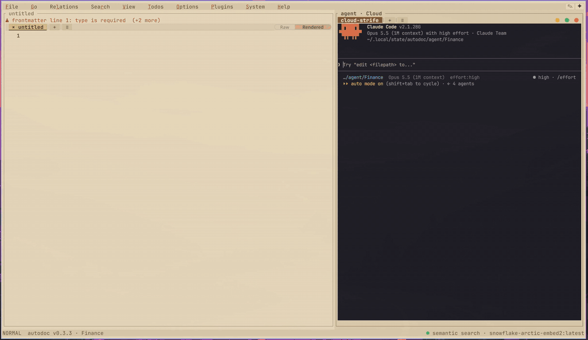
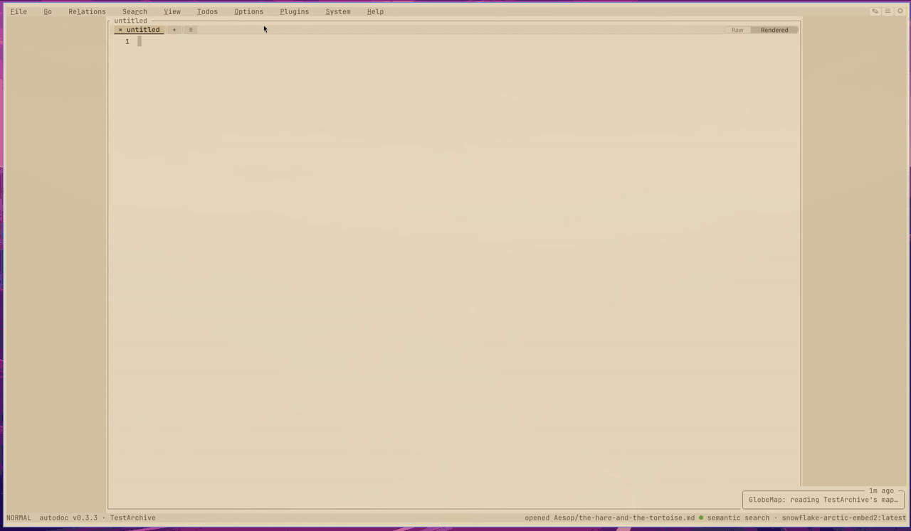
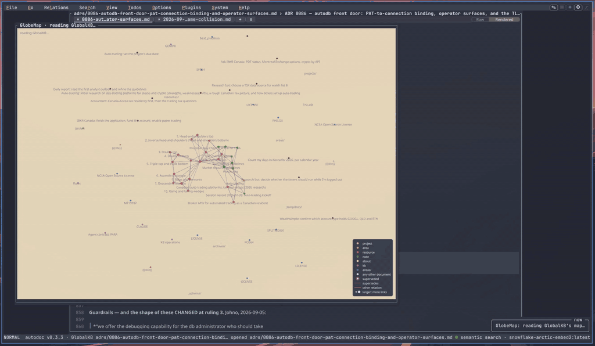
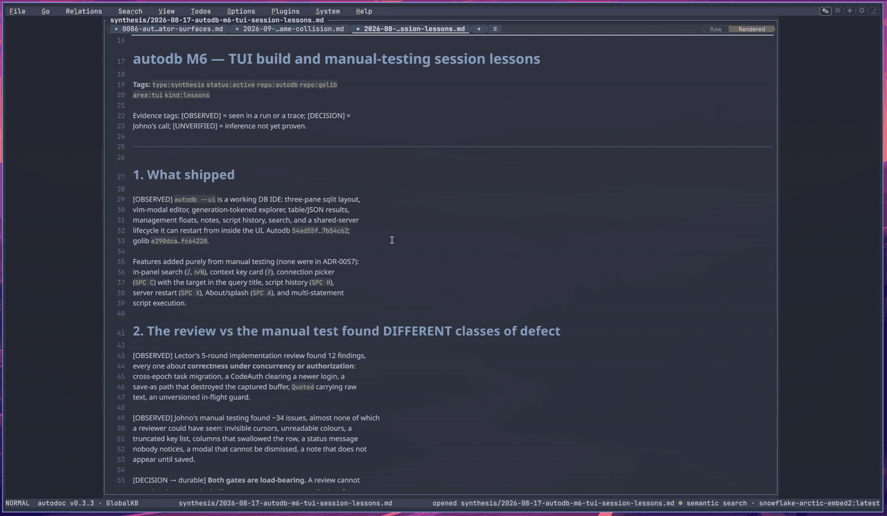
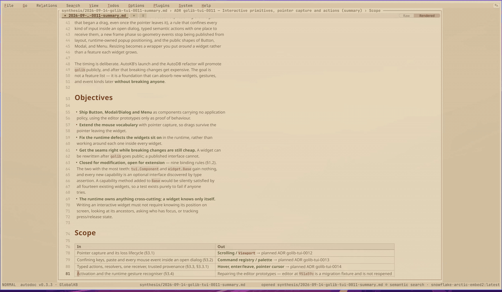
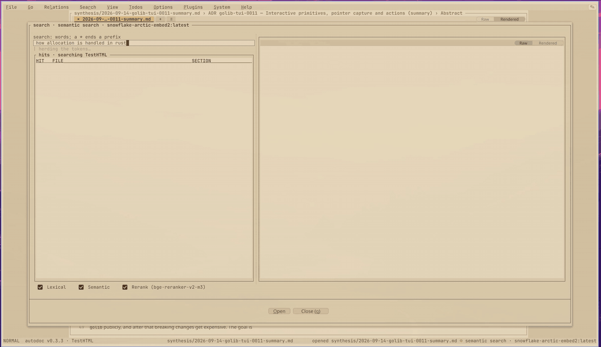
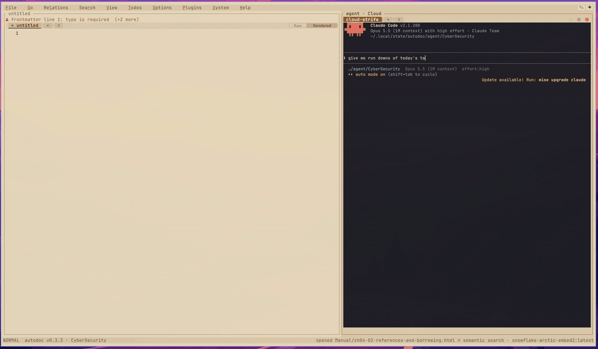
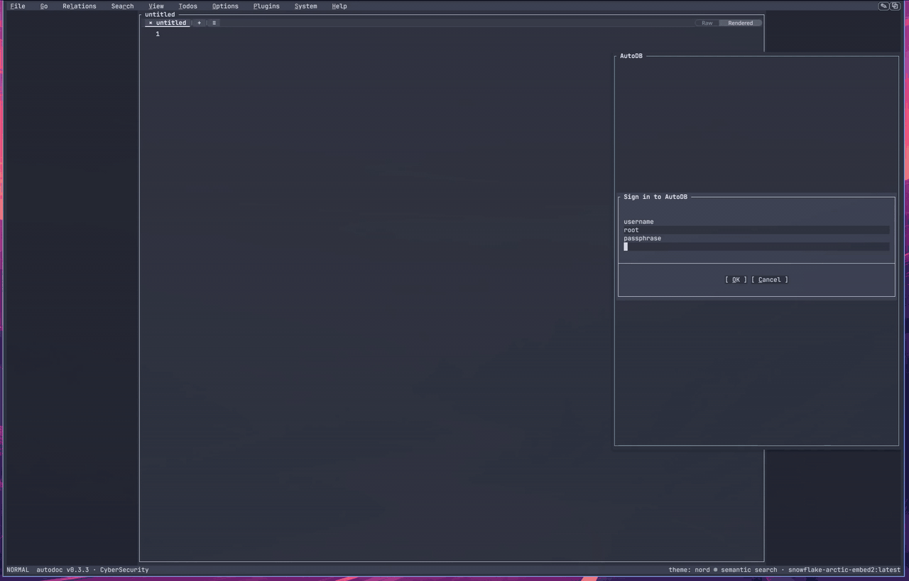

# AutoDoc



**A document knowledge base you and your AI agents work in together.**

AutoDoc keeps a folder of Markdown files as they are, and gives them an editor, search by words and
by meaning, the links between them, and room for AI agents to work beside you. It runs in your
terminal (`autodoc --ui`) or in a window of its own (`autodoc --gui`).

[Documentation](https://yongjohnlee80.github.io/autodoc/) ·
[Tutorials](docs/tutorials/README.md) ·
[Reference](docs/reference/README.md) ·
[Install](#quick-start)

## What it is for

### 1. Find it fast: one search, for you and your agents

The question is usually "where did we write that down?". AutoDoc answers it by meaning, not only by
the words you remember.

- **Search by meaning, then by order of relevance.** A search for "why did we pick SQLite" finds the
  note that says "we chose an embedded database". Words and meaning are searched together, and a
  reranker can order the top hits again.
- **The same search serves your AI agents.** An agent calls it with `autodoc --call search.query`
  and gets ranked passages, each with its file, the headings it sits under and its lines. It reads
  the passage it needs instead of grepping the tree and opening whole files.
- **What that saves.** Less time for you. For an agent, fewer files read and fewer tokens spent on
  a question.
- **Agents are told to work this way.** [AGENTS.md](AGENTS.md) tells an agent to search the
  workspace first, and how: the verbs, the query syntax and the errors. `autodoc --contracts`
  prints every verb's contract.

### 2. Make it yours: an editor you shape with Lua

The page is a Vim or ordinary-keys editor, and almost everything in it is a command you can call,
bind or replace.

- **Your own commands, keys and menu rows.** A Lua file adds a `:` command (`autodoc.command`), binds
  it to a key (`autodoc.map`) and puts it in a menu (`autodoc.menu`). Scripts can edit the page,
  call the daemon and react to the editor's events.
- **An agent can write them for you.** The [Lua reference](docs/lua/reference.md) documents every
  function a script can call, and `autodoc --commands-reference` lists every command by its id.
  Describe the command you want, and your agent has what it needs to write it.

### 3. Extend it: plugins you imagine, an agent can build

A plugin is a program AutoDoc runs beside your notes, in a dialog, a docked card or the results
panel.

- **A documented protocol and SDK.** [Writing a plugin](docs/plugins.md) covers the manifest, the
  protocol and the Go SDK in package `plugin`: cards, panels, results tables, menu rows and
  commands.
- **AutoDB is the proof.** The SQL workbench below is a plugin, built on that same protocol.
- **Add one from a git URL.** **Plugins › Add from a git URL…** clones it and asks before it builds
  anything. The [plugin registry](https://github.com/yongjohnlee80/autodoc-plugin-registry) lists
  the ones published.

## A tour

### AI agents beside your notes

AutoDoc runs AI agents' command lines (Claude Code, Codex, OpenCode and others) in a panel of their
own. Each starts in a folder where AutoDoc has written what it needs to know about your workspace,
and the `autodoc` on its path reaches the same index you search. The clip at the top of this page
is one at work: it searches, reads the passages it found, and writes its report. **SPC g** shows
the panel; **SPC a** sends it the page or the selection.

### Search by meaning



One search box over the whole workspace (**Ctrl+G**). It searches by words and, with an embedding
model, by meaning; a reranker can order the hits again. Check boxes under it turn each stage on and
off, so you can see what each one changes. An embedding model runs on your machine (Ollama) or at a
provider you choose.

### The links between notes: GlobeMap and Mindmap



**GlobeMap** draws every document of the workspace and the links among them, coloured by type or
folder; a click opens one. **Mindmap** draws the note you are on and its neighbours, and follows
you as you open them. Links come from `[[wikilinks]]`, Markdown links and typed frontmatter
(supersedes, sources, related).



### Diagrams and charts, drawn in place



Mermaid diagrams and Vega-Lite charts are drawn in the page's Rendered view (**Ctrl+T**), from a
fence or a file beside the note. A diagram the native renderer can't draw says why, and
`autodoc --check-diagram` checks one before you show it.

### HTML, and the Rendered view



In the window, an HTML file opens as text to edit or as its page, drawn natively, and
**File › Preview HTML** shows a note's export beside the editor, following the cursor as you type.
`autodoc --export html` writes a note as one offline page.

### Todos



Each workspace keeps its todo list as plain files, one per task (**SPC x**). Tasks move between
open, in progress, deferred and completed, and one can be handed to an AI agent in a keystroke. The
same tasks are reachable from agents and scripts through the `todos.*` verbs.

### Plugins: the AutoDB SQL workbench



[AutoDB](https://github.com/yongjohnlee80/autodb)'s plugin runs SQL from a note against your
databases and shows the rows in AutoDoc's results panel: sort them, copy them as CSV or Markdown,
or export them. It is a plugin like any other, built on the protocol in
[Writing a plugin](docs/plugins.md); [Reference, Chapter 16](docs/reference/16-autodb-live-sql-workbench.md)
covers it.

### Your own commands in Lua

```lua
-- today.lua: :today puts a dated heading at the cursor; Q, SPC u t and the right-click menu run it
autodoc.command{
  name = "today",
  help = "insert today's heading",
  run = function(ed) ed:insert("## " .. autodoc.date("%A, %Y-%m-%d") .. "\n") end,
}
autodoc.map{ mode = "normal", keys = "Q", command = "today" }
autodoc.map{ mode = "leader", keys = "t", command = "today", title = "today's heading" }
autodoc.menu{ where = "editor", title = "Insert &today's heading", command = "today" }
```

Drop it in your Lua folder (`~/.config/autodoc/lua/`), or ask your agent for one like it. The
[Lua tutorial](docs/lua/tutorial-vim-commands.md) goes from `:hello` to a command that searches the
workspace.

## Why AutoDoc

- **Your files stay yours.** Notes are plain Markdown on your disk. AutoDoc's index of them lives
  elsewhere, follows every change, and can always be rebuilt from the files.
- **One program, many ways in.** The terminal, a native window, Neovim
  ([autodoc.nvim](docs/reference/18-neovim-integration-and-kb-migration.md)), plugins and AI agents
  all reach the same notes through one daemon.
- **Search that understands.** By words, or with a model by meaning, ordered again by a reranker,
  for you and for your agents alike.
- **An editor for reading and writing.** A page centred on the screen, Vim or ordinary keys,
  diagrams, charts and tables drawn in place.
- **Built to be extended.** Lua for your own commands, and plugins for whole new tools.

## Quick start

1. **Install it.**
   - macOS: `brew install yongjohnlee80/tap/autodoc`
   - Linux: the `-gui` [release archive](https://github.com/yongjohnlee80/autodoc/releases/latest)
     for your machine (`amd64` or `arm64`). Homebrew on Linux installs the terminal UI alone.
   - Windows: use WSL2 and a Linux method.
2. **Start it.** `autodoc --gui` opens the window; `autodoc --ui` runs in your terminal. Either
   starts AutoDoc's background service when it isn't running.
3. **Add your notes.** **Go › Manage workspaces…** (SPC W), then **Add…**: a short name, and the
   folder your Markdown lives in. Then search it with **Ctrl+G**.

The [tutorials](docs/tutorials/README.md) go on from there, a few minutes each. Every way to install
it, `go install` and building from source included, is in
[Reference, Chapter 2](docs/reference/02-quickstart-and-workspaces.md).

## Learn more

- **[Documentation site](https://yongjohnlee80.github.io/autodoc/)**: the tutorials and the
  reference, with the full-length videos.
- **[Tutorials](docs/tutorials/README.md)**: from installing to your first plugin.
- **[Reference Book](docs/reference/README.md)**: every surface and setting.
- **[AGENTS.md](AGENTS.md)**: what an AI agent may call, and how.
- **[Lua reference](docs/lua/reference.md)** and **[writing a plugin](docs/plugins.md)**.
- **[Plugin registry](https://github.com/yongjohnlee80/autodoc-plugin-registry)**.
- **[Architecture](docs/architecture.md)**, **[CONVENTIONS.md](CONVENTIONS.md)** and
  **[CONTRIBUTING.md](CONTRIBUTING.md)**: how it is put together, and how to send a change.

## License

Apache License 2.0; see [LICENSE](LICENSE).
