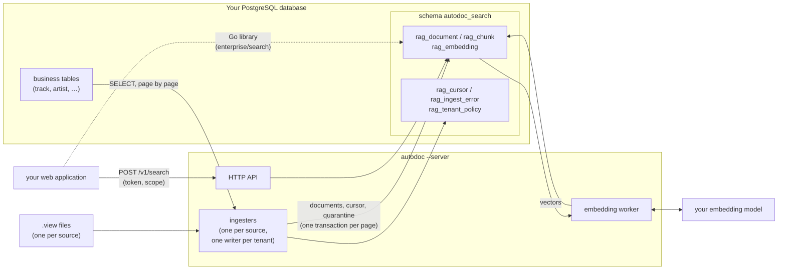

# Enterprise search

AutoDoc's enterprise search indexes your **database's rows**, not files, so your web applications
can search them by words and by meaning. One headless process, `autodoc --server`, reads the rows
through `.view` files, renders each into a document, chunks it, and keeps it in PostgreSQL with
pgvector, in a schema of its own beside your business tables. It keeps the index current as rows
change, embeds every chunk centrally with your embedding model, and answers search with an access
scope on every query.

Use it when:

- the thing to search is **data in a database** (a catalog, tickets, contracts), not a folder of
  notes;
- **many users** search the same index from a web application, each seeing only what they may;
- the **embedding model is the enterprise's**, run once per record on a server, not on every
  user's machine.

Use a local workspace (`autodoc --ui`) when the thing to search is your own files on your own
machine. Both use the same search engine and the same chunkers; the difference is where the text
comes from and where the index lives.

## How it fits together



- **A source** is one `.view` file: a SQL query that returns your rows as JSON, page by page, and a
  template that renders each row into a document. Each source is indexed into a **tenant** of its
  own, so sources refresh, re-cut and delete independently.
- **An ingester** per source keeps its tenant current. Every interval it reads the rows changed
  since its cursor, `(updated_at, id)`. Every refresh period it reads every row, writes the
  documents whose content changed, and deletes the documents of rows gone. A row that fails to
  render is quarantined and retried, never skipped. Each page of a pass is one transaction, with
  the cursor, so a crash in a pass replays at most one page. A refresh moves the cursor once, when
  it finishes; one interrupted by a crash starts over at the next refresh.
- **One writer per tenant.** An ingester holds its tenant's advisory lock on a connection of its
  own. A second server on the same tenant waits, and takes over if the first goes away.
- **The embedding worker**, one for the whole server, embeds every new chunk with your model, once
  per distinct text, and marks each document ready for search by meaning once all its chunks have
  vectors. It never holds up ingestion: a document answers by words until its vectors are in. A
  provider that is down is retried, with a growing wait, while the server goes on. Change the model
  in `server.toml` and the next start switches to it without a gap: searches answer by words while
  the new model fills, then the tenant flips to it and the old vectors are freed
  ([how the server embeds](server-config.md#how-the-server-embeds)).
- **Search** is a Go package your web application can import, and the same code behind an
  HTTP/JSON API. Every query carries an access scope (say, the labels a user may see), and
  PostgreSQL applies it apart from the query, so no query text can widen it.

Nothing is written to your business tables. The server's role needs `SELECT` on the tables its
views read and `CREATE` on the database for its own schema ([the grants](views.md#the-grants)).

## Getting started

1. Write a `.view` file for the rows you want searchable: **[Writing a `.view` source](views.md)**.
2. Write `server.toml`: **[The server configuration](server-config.md)**.
3. Check both against your database, read-only, and your embedding provider with one probe:

   ```sh
   export AUTODOC_SERVER_DSN='postgres://autodoc_search@db.internal/app'
   autodoc --server --check server.toml
   ```

4. Run it, under your supervisor (systemd, a container):

   ```sh
   autodoc --server server.toml
   ```

   It stops cleanly on SIGTERM, releasing its locks. It exits 2 when its configuration is refused
   (the field is named), and 1 when it cannot run or loses a tenant's lock, so the supervisor
   restarts it.

## Milestones

Enterprise search ships in four steps, each reviewed on its own:

| | What | Status |
|---|---|---|
| **M1** | `autodoc --server` and `--check`, `server.toml`, the `.view` ingestion: the incremental pass, the full refresh, quarantine, the writer lock. These docs. | done |
| **M2** | The central embedding worker, and switching models without a gap in search; `--check` probes the provider. | done |
| **M3** | The search package (`enterprise/search`) and the HTTP API, with access scopes and client tokens; each hit's `source_id`; the web-integration guide and an end-to-end tutorial. | done |
| **M4** | Operations: health and status, metrics in the log, a systemd unit and a container example; `proxy` and `refresh_retry`. | this release |

A web application searches the index through the Go library or the HTTP API: see
[web-integration](web-integration.md), and run the [tutorial](tutorial.md) for the whole path.

## In this folder

- **[The tutorial](tutorial.md)**: a music catalog indexed, embedded and searched from curl and from
  Go, end to end; CI runs it.
- **[Running the server](operations.md)**: health, status for operators, the metrics lines, a proxy in
  front, systemd and a container.
- **[Searching from a web application](web-integration.md)**: the Go library and the HTTP API, scopes,
  tokens, the errors, and highlighting.
- **[The server configuration](server-config.md)**: every field of `server.toml`, its default, and
  what is refused.
- **[Writing a `.view` source](views.md)**: the arguments, the order, the fields every row
  carries, the export path, access fields, the grants, and `--check`.
