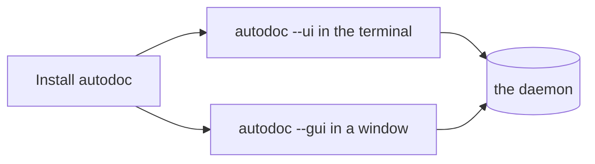

# Installing AutoDoc

AutoDoc is one program, `autodoc`. Pick the way that suits your machine:

| On | Install with |
| --- | --- |
| Linux, macOS, with Go | the window: `GOBIN=~/.local/bin go install -tags gui github.com/yongjohnlee80/autodoc/cmd/autodoc@latest` |
| Any, with Go | the terminal UI: `go install github.com/yongjohnlee80/autodoc/cmd/autodoc@latest` |
| macOS, Linux | mise: `mise use -g github:yongjohnlee80/autodoc` (with the window) |
| Linux, a server or container | mise, the terminal UI: `mise use -g 'github:yongjohnlee80/autodoc[asset_pattern=autodoc-*-linux-amd64-tui.tar.gz]'` (on arm64, `linux-arm64-tui`) |
| macOS, Linux | Homebrew: `brew install yongjohnlee80/tap/autodoc` (on Linux, the terminal UI) |
| Linux, macOS | a release archive from the project's Releases page, `amd64` or `arm64` |
| Windows | WSL2, then any Linux way |

**Two ways to run it.** `autodoc --ui` runs in your terminal. `autodoc --gui` opens a window of its own, with diagrams drawn and fonts you choose. `--gui` is how you run it; `-tags gui` is how Go builds the window in. On Linux, mise and the plain release archive have the window, and need a desktop's graphics libraries (EGL, Wayland, X11) even for `--ui`: on a server or in a container, take the `-tui` archive. Homebrew on Linux installs the terminal UI alone.

**The daemon starts itself.** Both talk to one background program, the daemon, which keeps the index of your files. The first `autodoc --ui` or `--gui` starts it; later ones share it. You never start it by hand.

`autodoc --version` says which version you have.

More: [Reference, Chapter 2: Quickstart and Workspaces](../reference/02-quickstart-and-workspaces.md).
