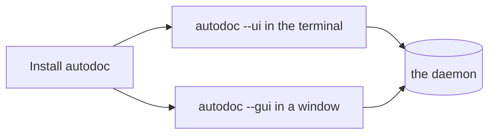

# Installing AutoDoc

AutoDoc is one program, `autodoc`.

The recommended way is a one-line install script: one for Linux and macOS, another for Windows.

## On Linux and macOS

On Linux and macOS, one line installs AutoDoc with its window:

```sh
curl -fsSL https://github.com/yongjohnlee80/autodoc/releases/latest/download/install-autodoc.sh | sh
```

The script:

- downloads the newest release for your system and checks it against the release's checksum;
- installs it as `~/.local/bin/autodoc`, for you alone: it never asks for `sudo`;
- adds a launcher, so AutoDoc is in your applications (AutoDoc.app on macOS, a desktop entry on Linux);
- installs `update.sh` in `~/.local/state/autodoc`, which keeps AutoDoc up to date.

If `~/.local/bin` isn't on your `PATH`, the script prints the line to add to your shell's startup file; it never edits that file itself. Where no ready-made build fits your system, it asks before building one from the release's source.

Run it again at any time: it upgrades or repairs the install and never adds a second launcher. `sh install-autodoc.sh --help` lists its options, such as `--version` for one release and `--no-launcher`.

**Updating.** Installed by the script, AutoDoc can update itself: **Help › About**, then **Update**. The update runs in AutoDoc's terminal panel, and when the new version is in place AutoDoc offers **Restart Now**. From a shell, `~/.local/state/autodoc/update.sh` does the same.

## On Windows

In PowerShell, one line installs AutoDoc with its window:

```powershell
irm https://github.com/yongjohnlee80/autodoc/releases/latest/download/install-autodoc.ps1 | iex
```

The script:

- downloads the newest Windows build and checks it against the release's checksum;
- installs it as `%LOCALAPPDATA%\Programs\AutoDoc\autodoc.exe`, for you alone: it never asks for administrator rights;
- adds AutoDoc to the Start menu;
- installs `update.ps1` in `%LOCALAPPDATA%\autodoc`, so **Help › About › Update** works as on Linux and macOS.

It changes your `PATH` only when asked (`-AddToPath`); otherwise it prints the command that would. The build is unsigned, so Windows may say the publisher is unknown the first time AutoDoc runs. Windows on arm64 has no build yet. Under WSL2, the Linux line above works too.

## Other ways

- Homebrew: `brew install yongjohnlee80/tap/autodoc` (on Linux, the terminal UI only)
- mise: `mise use -g github:yongjohnlee80/autodoc`
- Go: `go install -tags gui github.com/yongjohnlee80/autodoc/cmd/autodoc@latest` (without `-tags gui`, the terminal UI only)
- A release archive from the project's Releases page

These are updated the way they were installed (`brew upgrade`, `mise upgrade`, `go install` again), so **Help › About** offers no Update for them. Servers, containers and building from source: [Reference, Chapter 2](../reference/02-quickstart-and-workspaces.md).

**Two ways to run it.** `autodoc --ui` runs in your terminal. `autodoc --gui` opens a window of its own, with diagrams drawn and fonts you choose.



**The daemon starts itself.** Both talk to one background program, the daemon, which keeps the index of your files. The first `autodoc --ui` or `--gui` starts it; later ones share it. You never start it by hand.

`autodoc --version` says which version you have.

More: [Reference, Chapter 2: Quickstart and Workspaces](../reference/02-quickstart-and-workspaces.md).
