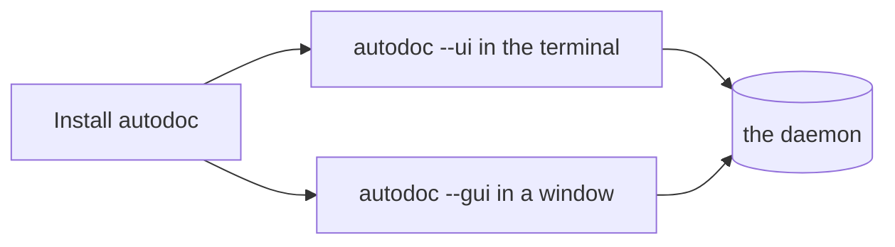

# Installing AutoDoc

AutoDoc is one program, `autodoc`. Pick the way that suits your machine:

| On | Install with |
| --- | --- |
| macOS, Linux | Homebrew: `brew install yongjohnlee80/tap/autodoc` |
| Linux, macOS | mise: `mise use -g github:yongjohnlee80/autodoc` |
| Linux, macOS | a release archive from the project's Releases page, `amd64` or `arm64` |
| Any, with Go | `go install github.com/yongjohnlee80/autodoc/cmd/autodoc@latest` |
| Windows | WSL2, then any Linux way |

**Two ways to run it.** `autodoc --ui` runs in your terminal. `autodoc --gui` opens a window of its own, with diagrams drawn and fonts you choose. On Linux the window needs a `-gui` release archive, or `go install -tags gui …`.

**The daemon starts itself.** Both talk to one background program, the daemon, which keeps the index of your files. The first `autodoc --ui` or `--gui` starts it; later ones share it. You never start it by hand.

`autodoc --version` says which version you have.

More: [Reference, Chapter 2: Quickstart and Workspaces](../reference/02-quickstart-and-workspaces.md).
