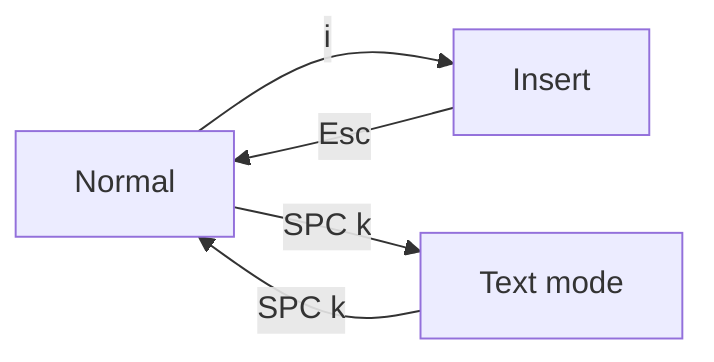

# The page, and its two editor modes

AutoDoc opens a file as a **page**: centred, as wide as reading wants, nothing else on screen until you ask for it.

It edits in one of two modes. **SPC k** (Options › Editor mode) switches them.

- **Vim** (the default): modal. `i` types, `Esc` goes back to Normal, and Normal's keys move and edit: `h j k l`, `w b e`, `dd`, `yy`, `p`, `u`. `?` shows the Vim keys' card.
- **Text**: modeless, an ordinary editor's keys. Typing types; the arrows move; Ctrl+C, Ctrl+X, Ctrl+V copy, cut and paste.

**The leader.** In Vim's Normal mode, **Space** opens the leader card: a key per command. In every mode, **Ctrl+Space** opens it. Most of what follows is a key on it.

**The menu bar** shows at the top. Set to hide (Options › Editor preferences), it hides until **F10** or **Alt+letter** brings it up (on a Mac, Option+letter). **SPC m** shows it and keeps it.

**The dock** is the menu bar's right end: an icon for each open widget. **✎** the editor comes first, then each panel that is open or still running behind its closed drawer: a terminal's shell, an agent, a plugin card's plugin. Point at an icon for its name. A click on a shown panel hides it, and a click on a hidden one brings it back as you left it, with the keyboard in it. A hidden panel keeps everything it holds, and its icon is dimmed. **✎** hides every shown panel; click it again to bring the same ones back. Opening a note from the GlobeMap, the Mindmap or the Links drawer hides it the same way. While the dock lists more than the editor, the bar stays up and the page sits a row lower.

**Ctrl+S** saves. **SPC o** opens a document of the workspace, **Ctrl+N** makes a new one, **Ctrl+Q** quits. In Normal mode **Ctrl+O** goes back to where you were, a link or a document ago, and **Ctrl+I** forward again.

More: [Reference, Chapter 3: Modal Editor and Panels](../reference/03-modal-editor-and-panels.md).
