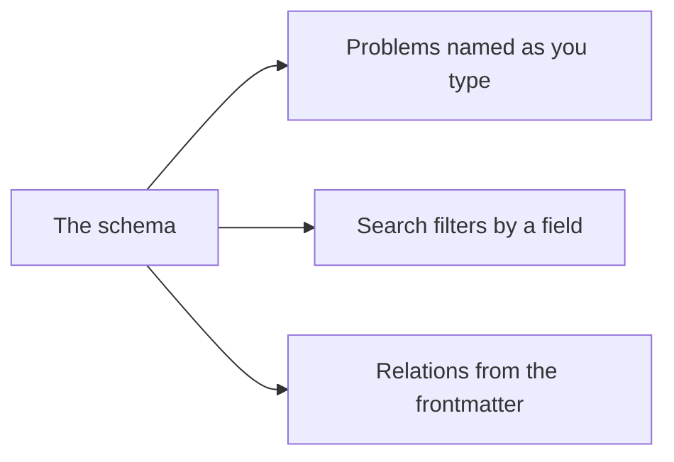

# Workspaces and their schema

A **workspace** is a folder AutoDoc indexes: its Markdown, text and YAML files, `.git` skipped.

- **Ctrl+W** (SPC w) switches workspace. In the Vim editor mode's Insert, Ctrl+W is Vim's and deletes a word: press Esc first.
- **Manage…** (SPC W) adds one (a name and its folder), renames it, edits it, or deletes it. Deleting removes the index only: the files stay.
- `autodoc --ui <name>` opens that workspace; without a name, the one used last.

**A schema** says what a document's frontmatter holds: its fields, their kinds, the values they take. Give the workspace one in **Manage… › Edit…**: name the file, suggested `.autodoc/schema.yaml`.

With a schema:

- the line over the page names a file's frontmatter problems as you type, never stopping a save;
- a search can filter by a field: `type:adr` finds the ADRs;
- the relations know the links the frontmatter makes: supersedes, sources, amends, related.

Without one, `field:value` is searched as words.

More: [Reference, Chapter 7: Frontmatter Schemas and Validation](../reference/07-frontmatter-schemas-and-validation.md).
