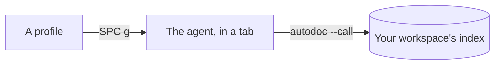

# The agents panel: AI agents beside your notes

AutoDoc runs AI agents' command lines (Claude Code, Codex, OpenCode, and others) in a panel of their own, each told about your workspace.

**On a first run** AutoDoc offers to set one up: it finds Claude Code, Codex, Grok or Antigravity on your PATH, and **Set up** saves the profile, starts the agent and has it say what it can do for you. **System › Set up an agent…** brings that card back.

**Add a profile.** **System › Agent profiles…** (SPC G), then **Add…**: a name, and the command that starts the agent, such as `claude --model opus` or `codex`. `{root}` and `{workspace}` in the command become the workspace's folder and name. The first profile is the default; **Make default** chooses another.

**SPC g** shows the panel, starting the default agent if none is running, and hides it again. A hidden agent keeps running.

**It knows your workspace.** An agent starts in AutoDoc's own folder for the workspace, where AutoDoc writes `AGENTS.md` and `CLAUDE.md`: the workspace's name and root, and how to reach it. The `autodoc` on its path is yours, so `autodoc --call workspace.list` and the other verbs reach the same index you search.

**Tabs.** Each agent has a tab, named by its codename. **+** starts another profile, or goes to one that's running. A tab's menu (`≡`, or a right click on the tabs) has **Go to**, **Restart**, **Close**, **Profiles…**, **Theme and font…**, **Maximize** and **Hide**.

**Inside the panel** every key goes to the agent, Esc too. **Ctrl+T** switches to Normal mode, to move over its history (`h j k l`, `/`, `v`, `y`); Esc there hides the panel.

**Send it your page.** **SPC a** opens the agents' card: **b** sends the page to an agent, **f** the selection.

In the GUI, **Options › Fonts and zoom…** sets the agents' text size, a share of the window's, from 50% to 150%; the panel's menu (≡) steps it by 10% (**Text size › Smaller**, **Larger**). The terminal panel shares it.

More: [Reference, Chapter 11: Embedded Terminal Tabs and One-Key Agent Task Handoff](../reference/11-terminal-tabs-and-agent-handoff.md), and [Reference, Chapter 12: AI Agent Integration, Adaptive Retrieval, and CLI RPC](../reference/12-ai-agent-integration-and-cli-rpc.md).
