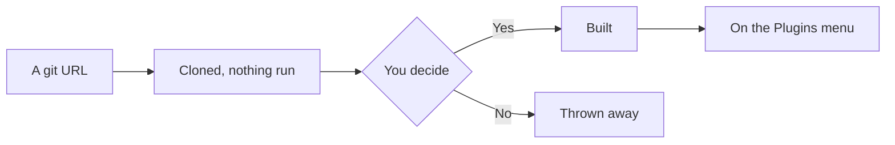

# Plugins: adding one, and using it

A **plugin** is a program of its own that AutoDoc runs: it keeps going while you write, draws its own dialog or card, and can reach files, the network and other tools. AutoDB, a SQL workbench, is one.

**Add one.** **Plugins › Add from a git URL…**, then the repository's address, for example `https://github.com/yongjohnlee80/autodb`.

1. AutoDoc clones it and runs nothing yet.
2. It shows what it would build and what it would start, and asks: **Yes, at my own risk**, or **No, cancel**. A plugin runs as you, with your files: add only plugins you trust. **Audit…** first has one of your agents read the code; click its notification to come back and decide.
3. Yes builds it, and the plugin appears on the **Plugins** menu.

**Or from the registry.** **Plugins › Browse the registry…** lists the plugins and Lua packages the registry knows, each with its audits. **Install** asks the same question, and says whether the commit it would install was audited. **Add from a git URL…** takes a registry name too.

**Three kinds.**

- A **dialog** opens over the page; Esc closes it.
- A **card** docks beside the page and keeps running while hidden. AutoDB is a card: it runs the statement under your cursor, and the rows go to AutoDoc's results table. Its **Turn off** item on the Plugins menu stops it.
- A **service** has no window; it works in the background.

**Its commands.** Each plugin's submenu on the **Plugins** menu has its commands. **SPC p** lists the plugins with commands: give one a letter of your own with `*`, then press that letter to see its commands, and a command's key runs it.

**Manage plugins…** places a plugin (left or right, where it can go), **Update…** brings it to its repository's latest, asking the same question again, and **Remove…** deletes it.

**Notifications.** A plugin can say what it did, or what went wrong, as a notification in the corner. **SPC h** keeps the history of them all.

More: [Reference, Chapter 15: Plugin Architecture & Registry](../reference/15-plugin-architecture-and-registry.md), and [Reference, Chapter 16: AutoDB Live SQL Workbench](../reference/16-autodb-live-sql-workbench.md).
