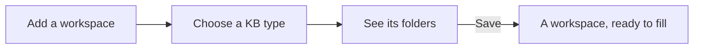

# KB types: a workspace that starts with a method

A new workspace can start empty, or from a **KB type**: the folders, templates and schema of a way of keeping notes, ready to fill.

**Add a workspace with a type.** **Go › Manage workspaces…** (SPC W), then **Add…**:

1. **root**: the folder. Type its full path and press **New Folder** to create it, or **Browse…** to pick one that exists.
2. **KB type**: choose one. AutoDoc fetches it and shows its folders and what each is for, before anything is written.
3. **Save**: the workspace is added, and the type's folders and files are created in it. A file that's already there is kept, never overwritten.

**The types.**

- **Zettelkasten**: fleeting, literature and permanent notes, and structure notes that tie them together.
- **PARA**: Projects, Areas, Resources and Archives.
- **Slip-box**: an inbox to capture, the slip-box of finished notes, references and projects.
- **AutoVim coding KB**: a project's decisions and knowledge: ADRs, conventions, playbooks, reviews and more, for people and AI agents working on code.
- **None**: an existing folder, or a code repository, as it is.
- **Custom URL…**: any KB type's `https://` git repository.

Each type also brings templates and a frontmatter schema, so new notes start in the right shape and the line over the page names what a note is missing. A type is only read and copied: nothing in it runs.

**An existing workspace** can take a type too. In a Lua command or `:lua`, `autodoc.run("kbtype.apply", "para.kb")` adds PARA's folders and files to the open workspace, again keeping every file already there.

More: [Reference, Chapter 2: Quickstart and Workspaces](../reference/02-quickstart-and-workspaces.md), and [Reference, Chapter 7: Frontmatter Schemas and Validation](../reference/07-frontmatter-schemas-and-validation.md).
