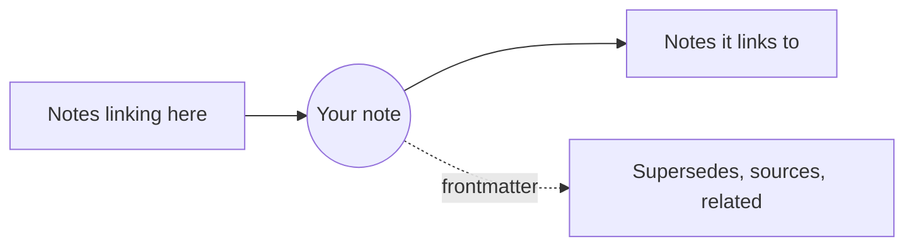

# Relations: Links, the Mindmap and the GlobeMap

Notes link to each other: by Markdown links, and by their frontmatter (supersedes, sources, related…). The **Relations** menu shows those links three ways.

**Links (SPC l).** A panel of the open note's connections: what it links to, its backlinks, and its frontmatter relations, each under its own heading. Links that name no document are listed too. **Enter** opens a note, and the panel closes; **d** also lists the notes two links away. Every terminal and window has it.

**The Mindmap** (in the GUI). Your note at the centre, the notes one link away around it; **d** reaches two. Click a note to open it, and the map centres on it.

**The GlobeMap** (in the GUI). The whole workspace at once: every note and every link, settling into place as you watch.

- drag to pan, the mouse wheel or **+** and **-** to zoom, **0** to fit it all again;
- **f** chooses which links show: every link, the body's links, or the frontmatter's relations;
- **l** shows or hides the legend;
- click a note to open it.

Colours come from **groups**, seeded from your schema's types and your folders, so a workspace's shape shows at a glance; the legend names them. **Relations › GlobeMap settings…** and **Mindmap settings…** choose how each draws: its theme, its colours, the names, and more.

More: [Reference, Chapter 8: Knowledge Graphs and the ADR Lifecycle](../reference/08-knowledge-graphs-and-adr-lifecycle.md).
