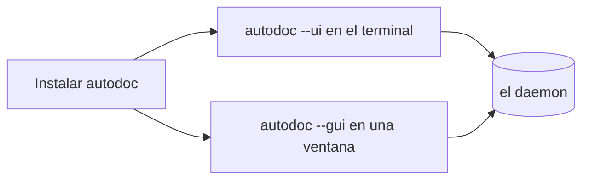

# Instalar AutoDoc

AutoDoc es un solo programa, `autodoc`.

La forma recomendada es un script de instalación, de una sola línea: uno para Linux y macOS y otro para Windows.

## En Linux y macOS

En Linux y macOS, una sola línea instala AutoDoc con su ventana:

```sh
curl -fsSL https://github.com/yongjohnlee80/autodoc/releases/latest/download/install-autodoc.sh | sh
```

El script:

- descarga la versión más reciente para tu sistema y la comprueba con el checksum de la versión;
- la instala como `~/.local/bin/autodoc`, solo para ti: nunca pide `sudo`;
- añade un lanzador, para que AutoDoc esté entre tus aplicaciones (AutoDoc.app en macOS, una entrada de escritorio en Linux);
- instala `update.sh` en `~/.local/state/autodoc`, que mantiene AutoDoc al día.

Si `~/.local/bin` no está en tu `PATH`, el script muestra la línea que debes añadir al archivo de inicio de tu shell; nunca edita ese archivo por sí mismo. Cuando ninguna versión ya compilada sirve para tu sistema, pregunta antes de compilar una a partir del código fuente de la versión.

Puedes ejecutarlo de nuevo cuando quieras: actualiza o repara la instalación y nunca añade un segundo lanzador. `sh install-autodoc.sh --help` lista sus opciones, como `--version` para una versión concreta y `--no-launcher`.

**Actualizar.** Instalado con el script, AutoDoc se actualiza solo: **Ayuda › Acerca de**, y luego **Actualizar**. La actualización se ejecuta en el panel de terminal de AutoDoc y, cuando la nueva versión está lista, AutoDoc ofrece **Reiniciar ahora**. Desde una shell, `~/.local/state/autodoc/update.sh` hace lo mismo.

## En Windows

En PowerShell, una línea instala AutoDoc con su ventana:

```powershell
irm https://github.com/yongjohnlee80/autodoc/releases/latest/download/install-autodoc.ps1 | iex
```

El script:

- descarga la compilación de Windows más reciente y la comprueba con la suma de verificación de la versión;
- la instala como `%LOCALAPPDATA%\Programs\AutoDoc\autodoc.exe`, solo para ti: nunca pide permisos de administrador;
- añade AutoDoc al menú Inicio;
- instala `update.ps1` en `%LOCALAPPDATA%\autodoc`, así que **Ayuda › Acerca de › Actualizar** funciona como en Linux y macOS.

Solo cambia tu `PATH` si se lo pides (`-AddToPath`); si no, muestra el comando que lo haría. La compilación no está firmada, así que Windows puede decir que el editor es desconocido la primera vez que se ejecuta AutoDoc. Windows en arm64 aún no tiene compilación. En WSL2 también funciona la línea de Linux de arriba.

## Otras formas

- Homebrew: `brew install yongjohnlee80/tap/autodoc` (en Linux, solo la interfaz de terminal)
- mise: `mise use -g github:yongjohnlee80/autodoc`
- Go: `go install -tags gui github.com/yongjohnlee80/autodoc/cmd/autodoc@latest` (sin `-tags gui`, solo la interfaz de terminal)
- Un archivo comprimido de la página de Releases del proyecto

Estas se actualizan de la misma forma en que se instalaron (`brew upgrade`, `mise upgrade`, `go install` otra vez), así que **Ayuda › Acerca de** no ofrece Actualizar para ellas. Servidores, contenedores y compilar desde el código fuente: [Referencia, capítulo 2](../../reference/02-quickstart-and-workspaces.md).

**Dos formas de ejecutarlo.** `autodoc --ui` se ejecuta en tu terminal. `autodoc --gui` abre una ventana propia, con los diagramas dibujados y las fuentes que elijas.



**El daemon se inicia solo.** Ambos hablan con un único programa en segundo plano, el daemon, que mantiene el índice de tus archivos. El primer `autodoc --ui` o `--gui` lo inicia; los siguientes lo comparten. Nunca tienes que iniciarlo a mano.

`autodoc --version` indica qué versión tienes.

Más: [Referencia, capítulo 2: Inicio rápido y espacios de trabajo](../../reference/02-quickstart-and-workspaces.md).
