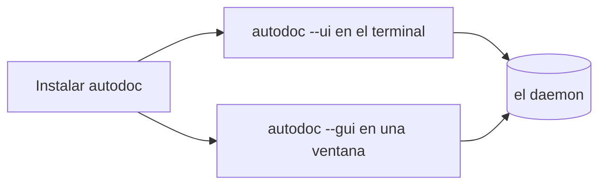

# Instalar AutoDoc

AutoDoc es un solo programa, `autodoc`. Elige la forma que mejor se adapte a tu equipo:

| En | Instalar con |
| --- | --- |
| macOS, Linux | Homebrew: `brew install yongjohnlee80/tap/autodoc` |
| Linux, macOS | mise: `mise use -g github:yongjohnlee80/autodoc` |
| Linux, macOS | un archivo comprimido de la página Releases del proyecto, `amd64` o `arm64` |
| Cualquiera, con Go | `go install github.com/yongjohnlee80/autodoc/cmd/autodoc@latest` |
| Windows | WSL2, y luego cualquier método de Linux |

**Dos formas de ejecutarlo.** `autodoc --ui` se ejecuta en tu terminal. `autodoc --gui` abre una ventana propia, con los diagramas dibujados y las fuentes que elijas. En Linux, la ventana necesita un archivo comprimido `-gui` de la versión, o `go install -tags gui …`.

**El daemon se inicia solo.** Ambos hablan con un único programa en segundo plano, el daemon, que mantiene el índice de tus archivos. El primer `autodoc --ui` o `--gui` lo inicia; los siguientes lo comparten. Nunca tienes que iniciarlo a mano.

`autodoc --version` indica qué versión tienes.

Más: [Referencia, capítulo 2: Inicio rápido y espacios de trabajo](../../reference/02-quickstart-and-workspaces.md).
