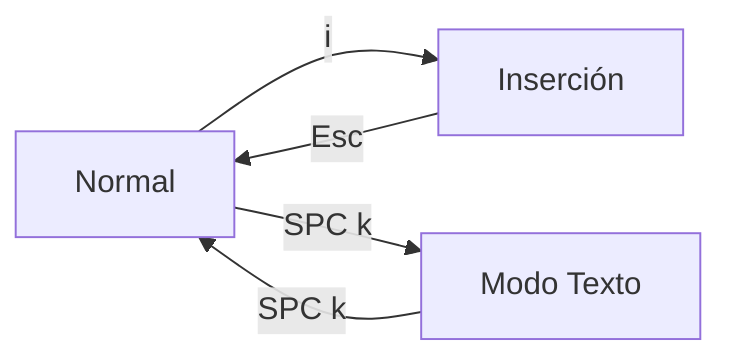

# La página y sus dos modos de edición

AutoDoc abre un archivo como una **página**: centrada, tan ancha como pide la lectura, y nada más en pantalla hasta que lo pidas.

Edita en uno de dos modos. **SPC k** (Opciones › Modo del editor) alterna entre ellos.

- **Vim** (el predeterminado): modal. `i` escribe, `Esc` vuelve a Normal, y las teclas de Normal mueven y editan: `h j k l`, `w b e`, `dd`, `yy`, `p`, `u`. `?` muestra la tarjeta de teclas de Vim.
- **Texto**: sin modos, con las teclas de un editor corriente. Lo que tecleas se escribe; las flechas mueven; Ctrl+C, Ctrl+X y Ctrl+V copian, cortan y pegan.

**El leader.** En el modo Normal de Vim, **Space** abre la tarjeta leader: una tecla por comando. En cualquier modo, **Ctrl+Space** la abre. Casi todo lo que sigue es una tecla de esa tarjeta.

**La barra de menús** permanece oculta hasta que **F10** o **Alt+letra** la hace aparecer (en un Mac, Option+letra). **SPC m** la muestra y la mantiene.

**El dock** es el extremo derecho de la barra de menús: un icono por cada widget abierto. Primero va **✎**, el editor, y después cada panel abierto o que sigue ejecutándose tras su cajón cerrado: el shell de un terminal, un agente, el plugin de una tarjeta de plugin. Pasa el puntero sobre un icono para ver su nombre. Un clic en un panel visible lo oculta, y un clic en uno oculto lo trae de vuelta tal como lo dejaste, con el teclado en él. Un panel oculto conserva todo lo que contiene, y su icono aparece atenuado. **✎** oculta todos los paneles visibles; vuelve a hacer clic para recuperar los mismos. Abrir una nota desde el GlobeMap, el Mindmap o el cajón de Enlaces lo oculta de la misma manera. Mientras el dock muestre algo más que el editor, la barra permanece visible y la página baja una fila.

**Ctrl+S** guarda. **SPC o** abre un documento del espacio de trabajo, **Ctrl+N** crea uno nuevo, **Ctrl+Q** sale. En modo Normal, **Ctrl+O** te lleva de vuelta a donde estabas, un enlace o un documento atrás, y **Ctrl+I** de nuevo hacia delante.

Más: [Referencia, capítulo 3: Editor modal y paneles](../../reference/03-modal-editor-and-panels.md).
