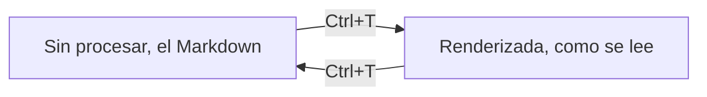

# La vista Renderizada: Ctrl+T

Con `autodoc --gui`, **Ctrl+T** alterna la página entre su vista **Sin procesar**, el Markdown tal como está escrito, y su vista **Renderizada**: los encabezados a su tamaño, las marcas ocultas, y las tablas, el código y los diagramas Mermaid dibujados.

La vista Renderizada sigue siendo el editor. Cada línea se puede editar: la línea bajo el cursor muestra su Markdown, y las demás muestran su resultado. Ctrl+T otra vez vuelve a Sin procesar.

**Los archivos HTML** preguntan cómo abrirse: **Simplificado**, su texto en solo lectura, o **Sin procesar**, el propio HTML para editarlo y guardarlo. La vista Renderizada de un archivo HTML sin procesar es su página, dibujada de forma nativa con sus propias hojas de estilo e imágenes: `j k` desplazan, y sus enlaces abren notas, archivos y el navegador.

**Archivo › Vista previa HTML** (SPC H) abre la página de la nota junto al editor, en vivo mientras escribes.

**El menú contextual**: Deshacer, Rehacer, Copiar, Cortar y Pegar, Ver diagrama, Ir al enlace, Atrás y, en la GUI, el Zoom. Desde el teclado: **Shift+F10**, la tecla **Menu** si tu teclado la tiene, o **SPC .**.

Un terminal no tiene vista Renderizada: allí la página se queda Sin procesar.

Más: [Referencia, capítulo 4: Redacción enriquecida, incrustaciones y exportación](../../reference/04-rich-authoring-embeds-and-export.md).
