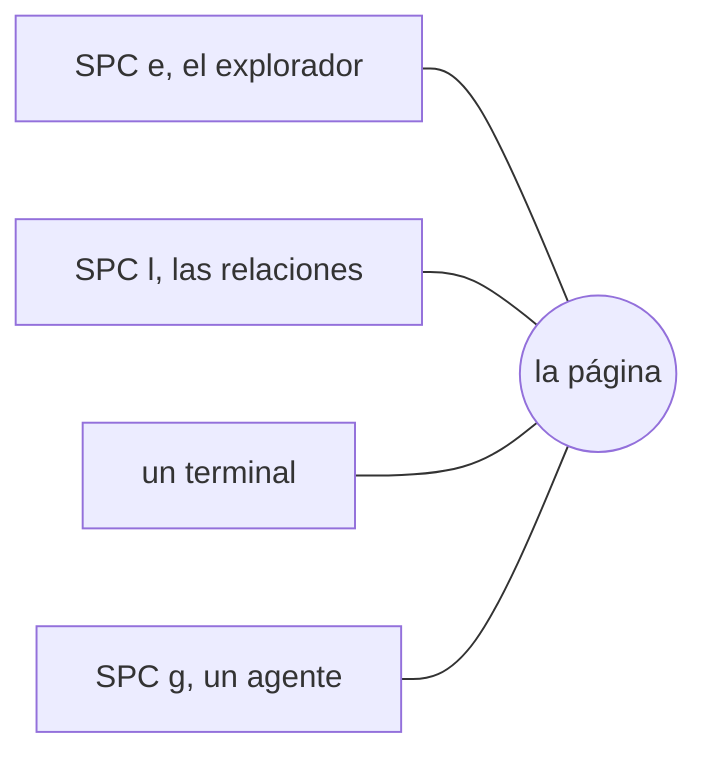

# La búsqueda y los paneles

**Ctrl+G** (o SPC SPC, SPC /) busca en el espacio de trabajo por palabras y, con un modelo, por significado: los resultados a la izquierda, y a la derecha el archivo en el punto del resultado. Enter lo abre.

**/** busca una palabra en el panel en el que estás; **n** y **N** la vuelven a buscar.

**Los paneles** se abren sobre la página, sin que la página se mueva nunca debajo de ellos:

- **SPC e** el explorador: las carpetas y archivos de todos los espacios de trabajo
- **SPC l** las relaciones: a qué enlaza este archivo y qué enlaza a él
- **SPC `** un terminal, que ejecuta tu shell en la carpeta del espacio de trabajo
- **SPC g** la CLI de un agente de IA (Sistema › Perfiles de agente…)

**Ctrl+h j k l** (modo Normal) van de la página a un panel y de vuelta.

**Todo panel se mueve y se redimensiona.** Alt (Option en un Mac) con el botón izquierdo lo arrastra a cualquier lugar; con el botón derecho lo redimensiona. **SPC L** (Ir › Organizar panel…) hace ambas cosas con el teclado: `h j k l` lo mueven, `H J K L` lo redimensionan, Enter lo conserva, Esc lo devuelve a su sitio. Se abre donde lo dejaste; **Ir › Restablecer disposición de paneles** vuelve a acoplarlos todos.

Más: [Referencia, capítulo 3: Editor modal y paneles](../../reference/03-modal-editor-and-panels.md), y [Referencia, capítulo 5: El flujo de búsqueda híbrida](../../reference/05-hybrid-search-pipeline.md).
