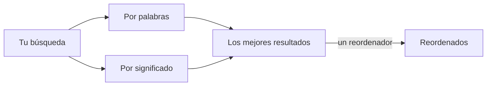

# Modelos de búsqueda: embeddings y un reordenador

Sin un modelo, la búsqueda es por palabras. **Sistema › Modelos de búsqueda…** (SPC s) añade los modelos que buscan por significado. Tiene dos pestañas.

Los **Embedding Models** (modelos de embeddings) convierten cada sección de tus archivos en un vector, para que una búsqueda encuentre lo que *significa* lo mismo.

1. Con **Añadir…**, añade un proveedor: un **Ollama** local con un modelo de embeddings (`ollama pull nomic-embed-text`), **Ollama Cloud**, o cualquier endpoint **compatible con OpenAI** con su clave.
2. Pulsa **Usar**. El espacio de trabajo se indexa en segundo plano; la marca de la línea de estado nombra el modelo que busca.
3. **Cancelar indexación** detiene una primera pasada larga; **Solo palabras** vuelve a la búsqueda por palabras.

Los **Ranker Models** (modelos de reordenación) son una segunda etapa: un reordenador lee los mejores resultados frente a tu pregunta y los vuelve a ordenar.

1. Con **Añadir…**, añade un reordenador: su tipo, su URL base y su modelo; **Comprobar** lo prueba.
2. Pulsa **Usar**. **Ventana…** fija cuántos de los mejores resultados lee.

Las casillas de la búsqueda (Léxica, Semántica, Reordenar) eligen las etapas de cada búsqueda.

Más: [Referencia, capítulo 6: Configuración de embeddings y reordenadores](../../reference/06-configuring-embeddings-and-rerankers.md).
