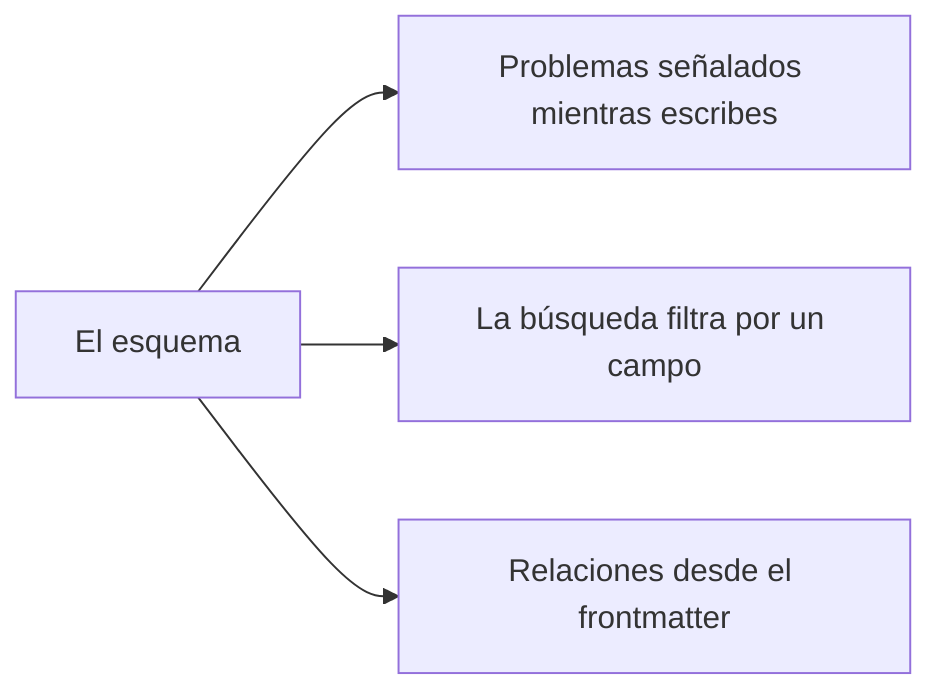

# Los espacios de trabajo y su esquema

Un **espacio de trabajo** es una carpeta que AutoDoc indexa: sus archivos Markdown, de texto y YAML, sin `.git`.

- **Ctrl+W** (SPC w) cambia de espacio de trabajo. En el modo Inserción del editor Vim, Ctrl+W es de Vim y borra una palabra: pulsa Esc antes.
- **Administrar…** (SPC W) añade uno (un nombre y su carpeta), lo renombra, lo edita o lo elimina. Eliminarlo borra solo el índice: los archivos se quedan.
- `autodoc --ui <name>` abre ese espacio de trabajo; sin nombre, el último que usaste.

**Un esquema** dice qué contiene el frontmatter de un documento: sus campos, sus tipos y los valores que admiten. Asigna uno al espacio de trabajo en **Administrar… › Editar…**: indica el archivo; se sugiere `.autodoc/schema.yaml`.

Con un esquema:

- la línea sobre la página señala los problemas del frontmatter de un archivo mientras escribes, sin impedir nunca un guardado;
- una búsqueda puede filtrar por un campo: `type:adr` encuentra los ADR;
- las relaciones conocen los enlaces que crea el frontmatter: reemplaza, fuentes, modifica, relacionado.

Sin esquema, `field:value` se busca como palabras.

Más: [Referencia, capítulo 7: Esquemas de frontmatter y validación](../../reference/07-frontmatter-schemas-and-validation.md).
