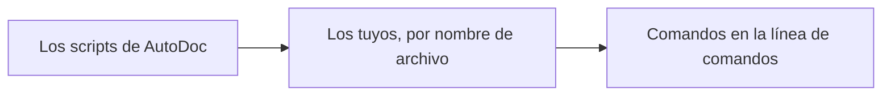

# Tus propios comandos, en Lua

La línea de comandos ejecuta comandos escritos en Lua: **:** la abre en el modo Normal de Vim, **Ctrl+;** en cualquier modo, y **Buscar › Línea de comandos…** donde un terminal no puede enviar Ctrl+;. `:table` y `:mermaid` son de AutoDoc; los tuyos van en **`~/.config/autodoc/lua/`**, junto a `config.toml`, como archivos `*.lua`.

**Orden de carga.** Al iniciar se cargan los scripts de AutoDoc y después los tuyos, por orden de nombre de archivo. Un comando con el mismo nombre que uno ya cargado lo reemplaza: los tuyos pueden reemplazar a los de AutoDoc, y un archivo posterior a uno anterior. Un archivo que no se puede cargar genera una notificación; los demás se cargan igualmente. Ejecuta **:lua-reload** (o guarda el archivo en AutoDoc) para cargar un archivo editado.



```lua
-- :upper [line] — upper-case a line, the cursor's by default
autodoc.command{
  name = "upper", aliases = {"up"}, args = "[line]", help = "upper-case a line",
  run = function(ed, args, line)
    local n = tonumber(args[1]) or ed:cursor()
    ed:replace(n, 1, n, #ed:line(n) + 1, ed:line(n):upper())
    autodoc.notify("upper-cased line " .. n)
  end,
}
```

**`name`** es lo que escribes, **`aliases`** son otros nombres para él, y **`args`** y **`help`** son lo que muestra Tab. **`run`** recibe el editor, `ed`; las palabras que siguen al comando, `args`; y el resto de la línea tal como se escribió, `line`.

**Cualquier comando, por su id.** `autodoc.run("todos.open")` ejecuta un comando de AutoDoc o tuyo (`autodoc.run("lua.upper", "3")`) y devuelve `ok, err`; F1 lista todos los id bajo COMANDOS.

**El editor, `ed`.** Las posiciones empiezan en 1: la línea 1, columna 1 es el primer carácter. Un rango va desde su inicio hasta su final, sin incluirlo: `ed:text(2, 1, 2, 6)` son los cinco primeros caracteres de la línea 2. `ed:cursor()` y `ed:selection()` dicen dónde estás; `ed:insert`, `ed:replace` y `ed:delete` editan; `ed:find(term)` busca; `ed:run("12")` ejecuta otro comando. Todo lo que edita un comando es **un solo deshacer**: `u` lo revierte entero.

**El sandbox.** Los scripts tienen las bibliotecas base, table, string y math de Lua: sin `os`, sin `io`, sin archivos, sin `require`. Un script que falla, o que pasa de dos segundos, se detiene; su error aparece en el prompt, y AutoDoc sigue adelante.

**El tutorial completo**, paso a paso desde `:hello` hasta un `:link` que consulta al daemon, es `docs/lua/tutorial-vim-commands.md` en el repositorio de AutoDoc.

Más: [Referencia, capítulo 14: Scripts en Lua y comandos personalizados](../../reference/14-lua-scripting-and-custom-commands.md).
