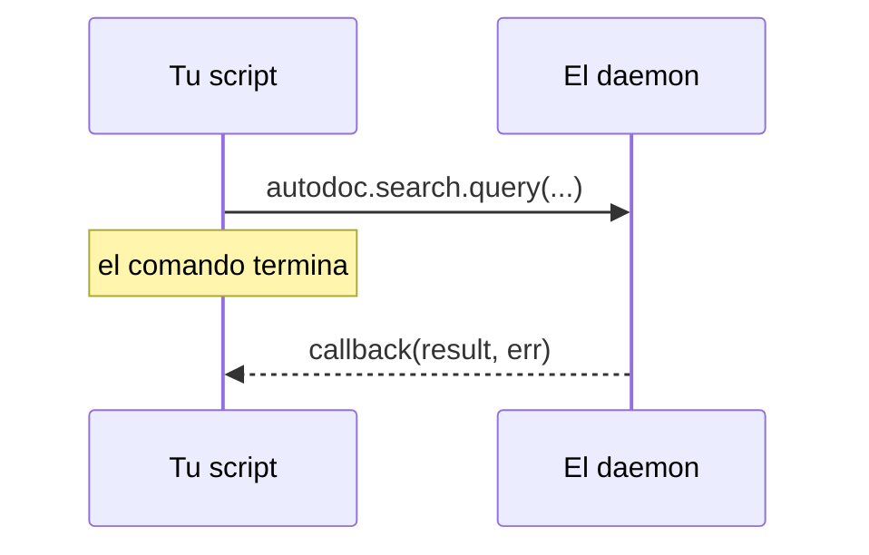

# Lua llama al daemon

Un script puede pedirle al daemon lo mismo que le pide la TUI: buscar, leer un archivo, listar los espacios de trabajo. Cada verbo que el daemon ofrece a los scripts es una función bajo `autodoc`, con su nombre:

```lua
autodoc.command{ name = "kestrels", run = function(ed)
  autodoc.search.query("kb", "kestrel", {limit = 5}, function(res, err)
    if err then autodoc.notify("search failed: " .. err) return end
    autodoc.notify(#res.hits .. " hits; the first is " .. res.hits[1].path)
  end)
end }
```

**La respuesta llega después.** La llamada vuelve enseguida, y la respuesta del daemon va al callback, el último argumento: `function(result, err)`. Para entonces el comando ya ha terminado, así que el trabajo se hace en el callback. Se ejecuta como un comando: dos segundos, `ed` accesible, sus ediciones un solo deshacer. La página puede haber cambiado mientras tanto, así que vuelve a leer allí las posiciones.



**Los parámetros** son los del verbo, en orden; los opcionales del final se pueden omitir. Un número incorrecto de ellos es un error en la llamada, que los nombra. Una tabla con claves 1, 2, 3… se envía como lista, cualquier otra como mapa, y los números enteros como enteros; el resultado vuelve como tablas de Lua.

**`autodoc.current_workspace()`** es el espacio de trabajo en uso (nil antes de entrar en uno): el primer parámetro que reciben la mayoría de los verbos.

**`autodoc.call(verb, params, cb)`** llega a un verbo por su nombre, con los parámetros como lista: `autodoc.call("doc.read", {"kb", "a.md"}, cb)`. Las funciones del estilo de `autodoc.search` se crean cuando AutoDoc se conecta, a partir del daemon al que está conectado: úsalas dentro de `run`, no al principio de un archivo.

**¿Qué verbos?** `autodoc --contracts` imprime cada verbo, sus parámetros y su resultado; `autodoc --contracts 'search.*' --format md`, un dominio, en tablas. Los verbos propios del protocolo (`sys.hello`, `sys.shutdown`) se les niegan a los scripts.

**Errores.** Una llamada fallida llega al callback como `err`, el código y el mensaje del daemon: `"-32061 not found"` (`--contracts` lista los códigos). Sin callback, el fallo es una notificación. También lo es un callback que falla o tarda demasiado: **SPC h** las muestra todas.

Más: [Referencia, capítulo 14: Scripts en Lua y comandos personalizados](../../reference/14-lua-scripting-and-custom-commands.md).
