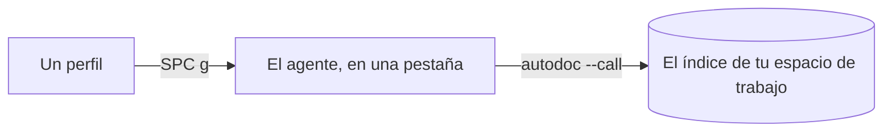

# El panel de agentes: agentes de IA junto a tus notas

AutoDoc ejecuta las líneas de comandos de agentes de IA (Claude Code, Codex, OpenCode y otros) en un panel propio, y a cada uno le informa de tu espacio de trabajo.

**En el primer inicio**, AutoDoc ofrece configurar uno: busca Claude Code, Codex, Grok o Antigravity en tu PATH, y **Configurar** guarda el perfil, inicia el agente y hace que te cuente qué puede hacer por ti. **Sistema › Configurar un agente…** vuelve a mostrar esa tarjeta.

**Añadir un perfil.** **Sistema › Perfiles de agente…** (SPC G), y luego **Añadir…**: un nombre y el comando que inicia el agente, como `claude --model opus` o `codex`. `{root}` y `{workspace}` en el comando se sustituyen por la carpeta y el nombre del espacio de trabajo. El primer perfil es el predeterminado; **Marcar como predeterminado** elige otro.

**SPC g** muestra el panel, iniciando el agente predeterminado si no hay ninguno en ejecución, y lo vuelve a ocultar. Un agente oculto sigue ejecutándose.

**Conoce tu espacio de trabajo.** Un agente se inicia en la carpeta propia de AutoDoc para el espacio de trabajo, donde AutoDoc escribe `AGENTS.md` y `CLAUDE.md`: el nombre y la raíz del espacio de trabajo, y cómo acceder a él. El `autodoc` de su PATH es el tuyo, así que `autodoc --call workspace.list` y los demás verbos llegan al mismo índice en el que buscas.

**Pestañas.** Cada agente tiene una pestaña, con su nombre en clave. **+** inicia otro perfil, o va a uno que ya está en ejecución. El menú de una pestaña (`≡`, o un clic derecho en las pestañas) tiene **Ir a**, **Reiniciar**, **Cerrar**, **Perfiles…**, **Tema y fuente…**, **Maximizar** y **Ocultar**.

**Dentro del panel**, todas las teclas van al agente, también Esc. **Ctrl+T** pasa al modo Normal, para recorrer su historial (`h j k l`, `/`, `v`, `y`); Esc ahí oculta el panel.

**Envíale tu página.** **SPC a** abre la tarjeta de agentes: **b** envía la página a un agente, **f** la selección.

En la GUI, **Opciones › Fuentes y zoom…** fija el tamaño del texto de los agentes, como proporción del de la ventana.

Más: [Referencia, capítulo 11: Pestañas de terminal integradas y traspaso de tareas a agentes con una tecla](../../reference/11-terminal-tabs-and-agent-handoff.md), y [Referencia, capítulo 12: Integración de agentes de IA, recuperación adaptativa y RPC por CLI](../../reference/12-ai-agent-integration-and-cli-rpc.md).
