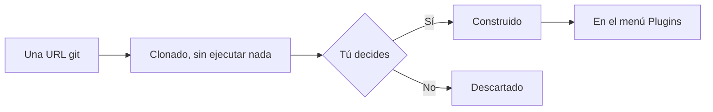

# Plugins: añadir uno y usarlo

Un **plugin** es un programa propio que AutoDoc ejecuta: sigue funcionando mientras escribes, dibuja su propio diálogo o tarjeta, y puede acceder a archivos, a la red y a otras herramientas. AutoDB, un banco de trabajo SQL, es uno de ellos.

**Añadir uno.** **Plugins › Añadir desde una URL git…**, y luego la dirección del repositorio, por ejemplo `https://github.com/yongjohnlee80/autodb`.

1. AutoDoc lo clona y todavía no ejecuta nada.
2. Muestra lo que construiría y lo que iniciaría, y pregunta: **Sí, bajo mi propio riesgo**, o **No, cancelar**. Un plugin se ejecuta como tú, con tus archivos: añade solo plugins de confianza. **Auditar…** hace primero que uno de tus agentes lea el código; haz clic en su notificación para volver y decidir.
3. Sí lo construye, y el plugin aparece en el menú **Plugins**.

**O desde el registro.** **Plugins › Explorar el registro…** lista los plugins y paquetes Lua que conoce el registro, cada uno con sus auditorías. **Instalar** hace la misma pregunta, e indica si el commit que instalaría fue auditado. **Añadir desde una URL git…** también acepta un nombre del registro.

**Tres tipos.**

- Un **diálogo** se abre sobre la página; Esc lo cierra.
- Una **tarjeta** se acopla junto a la página y sigue ejecutándose mientras está oculta. AutoDB es una tarjeta: ejecuta la sentencia bajo tu cursor, y las filas van a la tabla de resultados de AutoDoc. Su elemento **Desactivar** del menú Plugins la detiene.
- Un **servicio** no tiene ventana; trabaja en segundo plano.

**Sus comandos.** El submenú de cada plugin en el menú **Plugins** tiene sus comandos. **SPC p** lista los plugins con comandos: asígnale a uno una letra propia con `*`, luego pulsa esa letra para ver sus comandos, y la tecla de un comando lo ejecuta.

**Administrar plugins…** coloca un plugin (a la izquierda o a la derecha, donde pueda ir), **Actualizar…** lo lleva a la última versión de su repositorio, volviendo a hacer la misma pregunta, y **Eliminar…** lo borra.

**Notificaciones.** Un plugin puede contar lo que hizo, o lo que salió mal, con una notificación en la esquina. **SPC h** guarda el historial de todas.

Más: [Referencia, capítulo 15: Arquitectura de plugins y registro](../../reference/15-plugin-architecture-and-registry.md), y [Referencia, capítulo 16: AutoDB, banco de trabajo SQL en vivo](../../reference/16-autodb-live-sql-workbench.md).
