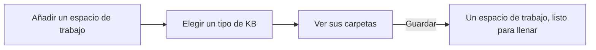

# Tipos de KB: un espacio de trabajo que empieza con un método

Un espacio de trabajo nuevo puede empezar vacío o a partir de un **tipo de KB**: las carpetas, plantillas y esquema de una forma de organizar notas, listos para llenar.

**Añadir un espacio de trabajo con un tipo.** **Ir › Administrar espacios de trabajo…** (SPC W), y luego **Añadir…**:

1. **raíz**: la carpeta. Escribe su ruta completa y pulsa **Nueva carpeta** para crearla, o **Examinar…** para elegir una que ya exista.
2. **tipo de KB**: elige uno. AutoDoc lo descarga y muestra sus carpetas y para qué sirve cada una, antes de escribir nada.
3. **Guardar**: se añade el espacio de trabajo, y se crean en él las carpetas y archivos del tipo. Un archivo que ya existe se conserva; nunca se sobrescribe.

**Los tipos.**

- **Zettelkasten**: notas fugaces, de lectura y permanentes, y notas de estructura que las enlazan.
- **PARA**: proyectos, áreas, recursos y archivo.
- **Slip-box**: una bandeja de entrada para capturar, el fichero de notas terminadas, referencias y proyectos.
- **AutoVim coding KB**: las decisiones y el conocimiento de un proyecto (ADR, convenciones, playbooks, revisiones y más), para personas y agentes de IA que trabajan con código.
- **Ninguno**: una carpeta existente, o un repositorio de código, tal como está.
- **URL personalizada…**: el repositorio git `https://` de cualquier tipo de KB.

Cada tipo trae además plantillas y un esquema de frontmatter, para que las notas nuevas empiecen con la forma correcta y la línea sobre la página señale lo que le falta a una nota. Un tipo solo se lee y se copia: nada de él se ejecuta.

**Un espacio de trabajo existente** también puede adoptar un tipo. En un comando Lua o en `:lua`, `autodoc.run("kbtype.apply", "para.kb")` añade las carpetas y archivos de PARA al espacio de trabajo abierto, conservando también todos los archivos que ya existen.

Más: [Referencia, capítulo 2: Inicio rápido y espacios de trabajo](../../reference/02-quickstart-and-workspaces.md), y [Referencia, capítulo 7: Esquemas de frontmatter y validación](../../reference/07-frontmatter-schemas-and-validation.md).
