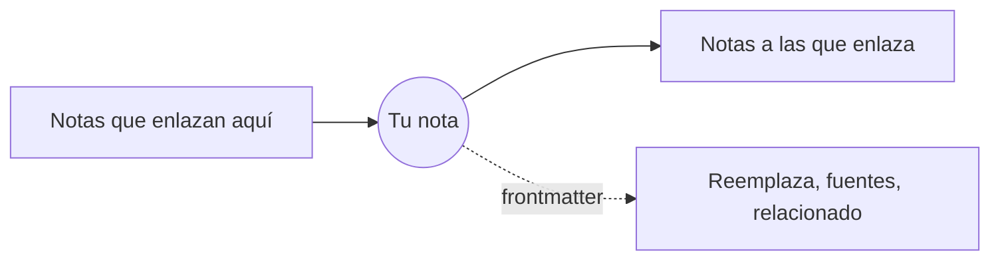

# Relaciones: Enlaces, el Mindmap y el GlobeMap

Las notas se enlazan entre sí: mediante enlaces Markdown y mediante su frontmatter (reemplaza, fuentes, relacionado…). El menú **Relaciones** muestra esos enlaces de tres maneras.

**Enlaces (SPC l).** Un panel con las conexiones de la nota abierta: a qué enlaza, sus retroenlaces y sus relaciones de frontmatter, cada una bajo su propio encabezado. También se listan los enlaces que no apuntan a ningún documento. **Enter** abre una nota y cierra el panel; **d** lista además las notas a dos enlaces de distancia. Todos los terminales y ventanas lo tienen.

**El Mindmap** (en la GUI). Tu nota en el centro y, a su alrededor, las notas a un enlace de distancia; **d** llega hasta dos. Haz clic en una nota para abrirla, y el mapa se centra en ella.

**El GlobeMap** (en la GUI). Todo el espacio de trabajo a la vez: cada nota y cada enlace, colocándose en su sitio mientras miras.

- arrastra para desplazarte, usa la rueda o **+** y **-** para hacer zoom, y **0** para volver a encajarlo todo;
- **f** elige qué enlaces se muestran: todos, los del cuerpo o las relaciones del frontmatter;
- **l** muestra u oculta la leyenda;
- haz clic en una nota para abrirla.

Los colores vienen de los **grupos**, que parten de los tipos de tu esquema y de tus carpetas, para que la forma de un espacio de trabajo se vea de un vistazo; la leyenda los nombra. **Relaciones › Ajustes de GlobeMap…** y **Ajustes de Mindmap…** eligen cómo se dibuja cada uno: su tema, sus colores, los nombres y más.

Más: [Referencia, capítulo 8: Grafos de conocimiento y el ciclo de vida de los ADR](../../reference/08-knowledge-graphs-and-adr-lifecycle.md).
