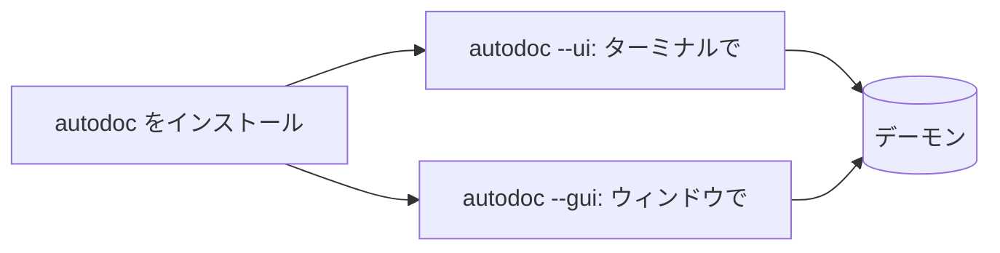

# AutoDoc のインストール

AutoDoc は `autodoc` という 1 つのプログラムです。

## インストールスクリプト (おすすめ)

Linux と macOS では、次の 1 行でウィンドウ版の AutoDoc がインストールされます。

```sh
curl -fsSL https://github.com/yongjohnlee80/autodoc/releases/latest/download/install-autodoc.sh | sh
```

このスクリプトは次のことを行います。

- お使いのシステム向けの最新リリースをダウンロードし、リリースのチェックサムで検証します。
- `~/.local/bin/autodoc` として、あなたのユーザーだけにインストールします。`sudo` は一切求めません。
- ランチャーを追加し、AutoDoc をアプリケーション一覧に表示します (macOS では AutoDoc.app、Linux ではデスクトップエントリ)。
- AutoDoc を最新に保つ `update.sh` を `~/.local/state/autodoc` にインストールします。

`~/.local/bin` が `PATH` に入っていない場合は、シェルの起動ファイルに追加する行を表示します。そのファイルを自分で書き換えることはありません。お使いのシステムに合うビルド済みのものがない場合は、リリースのソースからビルドしてよいか先に確認します。

いつ実行し直しても構いません。インストールを更新または修復し、ランチャーを二重に追加することはありません。`sh install-autodoc.sh --help` でオプションの一覧が出ます (特定のリリースを入れる `--version`、`--no-launcher` など)。

**アップデート。** スクリプトでインストールした AutoDoc は自分で更新できます。**ヘルプ › バージョン情報** を開き、**更新** を押します。更新は AutoDoc のターミナルパネルで実行され、新しいバージョンの準備ができると **今すぐ再起動** を提案します。シェルからは `~/.local/state/autodoc/update.sh` で同じことができます。

## ほかの方法

- Homebrew: `brew install yongjohnlee80/tap/autodoc` (Linux ではターミナル版のみ)
- mise: `mise use -g github:yongjohnlee80/autodoc`
- Go: `go install -tags gui github.com/yongjohnlee80/autodoc/cmd/autodoc@latest` (`-tags gui` なしではターミナル版のみ)
- プロジェクトの Releases ページのリリースアーカイブ
- Windows: WSL2 を入れてから、インストールスクリプト

これらはインストールしたときと同じ方法で更新します (`brew upgrade`、`mise upgrade`、もう一度 `go install`)。そのため **ヘルプ › バージョン情報** に更新ボタンは出ません。サーバー、コンテナ、ソースからのビルドについては [リファレンス 第 2 章](../../reference/02-quickstart-and-workspaces.md) を参照してください。

**実行方法は 2 つあります。** `autodoc --ui` はターミナルの中で動きます。`autodoc --gui` は専用のウィンドウを開き、図を描画し、お好みのフォントで表示します。



**デーモンは自動で起動します。** どちらも、ファイルのインデックスを保持するバックグラウンドプログラム「デーモン」とやり取りします。最初に実行した `autodoc --ui` または `--gui` がデーモンを起動し、以降はそれを共有します。手動で起動する必要はありません。

`autodoc --version` で、お使いのバージョンを確認できます。

詳しくは: [リファレンス 第 2 章: クイックスタートとワークスペース](../../reference/02-quickstart-and-workspaces.md)。
