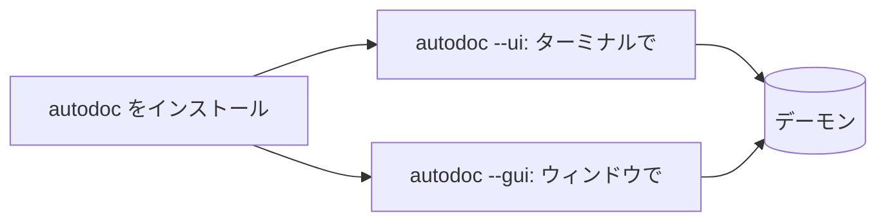

# AutoDoc のインストール

AutoDoc は `autodoc` というひとつのプログラムです。お使いのマシンに合った方法を選んでください。

| 対象 | インストール方法 |
| --- | --- |
| Linux、macOS (Go あり) | ウィンドウ版: `GOBIN=~/.local/bin go install -tags gui github.com/yongjohnlee80/autodoc/cmd/autodoc@latest` |
| Go があればどこでも | ターミナル版: `go install github.com/yongjohnlee80/autodoc/cmd/autodoc@latest` |
| macOS、Linux | mise: `mise use -g github:yongjohnlee80/autodoc` (ウィンドウ版) |
| Linux (サーバーやコンテナ) | mise でターミナル版: `mise use -g 'github:yongjohnlee80/autodoc[asset_pattern=autodoc-*-linux-amd64-tui.tar.gz]'` (arm64 では `linux-arm64-tui`) |
| macOS、Linux | Homebrew: `brew install yongjohnlee80/tap/autodoc` (Linux ではターミナル版) |
| Linux、macOS | プロジェクトの Releases ページにあるリリースアーカイブ (`amd64` または `arm64`) |
| Windows | WSL2 を入れてから、Linux のいずれかの方法で |

**実行方法は 2 つあります。** `autodoc --ui` はターミナルの中で動きます。`autodoc --gui` は専用のウィンドウを開き、図を描画し、お好みのフォントで表示します。`--gui` は実行するときのフラグ、`-tags gui` は Go がウィンドウ版をビルドするためのビルドタグです。Linux では、mise と接尾辞なしのリリースアーカイブがウィンドウ版で、`--ui` で使うときでもデスクトップのグラフィックライブラリ (EGL、Wayland、X11) が必要です。サーバーやコンテナでは `-tui` アーカイブを使ってください。Linux の Homebrew はターミナル版だけを入れます。

**デーモンは自動で起動します。** どちらも、ファイルのインデックスを保持するバックグラウンドプログラム「デーモン」とやり取りします。最初に実行した `autodoc --ui` または `--gui` がデーモンを起動し、以降はそれを共有します。手動で起動する必要はありません。

`autodoc --version` で、お使いのバージョンを確認できます。

詳しくは: [リファレンス 第 2 章: クイックスタートとワークスペース](../../reference/02-quickstart-and-workspaces.md)。
