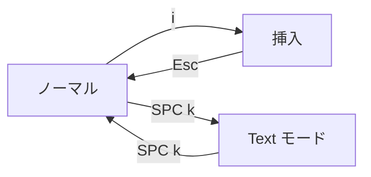

# ページと 2 つのエディターモード

AutoDoc はファイルを **ページ** として開きます。ページは中央に、読みやすい幅で表示され、呼び出すまでほかには何も表示されません。

編集には 2 つのモードがあります。**SPC k** (オプション › エディターモード) で切り替えます。

- **Vim** (既定): モーダル編集です。`i` で入力を始め、`Esc` でノーマルモードに戻ります。ノーマルモードではキーで移動や編集をします: `h j k l`、`w b e`、`dd`、`yy`、`p`、`u`。`?` で Vim のキーのカードを表示します。
- **Text**: モードレスで、一般的なエディターと同じキー操作です。キーを打てばそのまま入力され、矢印キーで移動し、Ctrl+C、Ctrl+X、Ctrl+V でコピー、切り取り、貼り付けができます。

**リーダー。** Vim のノーマルモードでは、**Space** でリーダーカードが開きます。コマンドごとにキーが割り当てられたカードです。どのモードでも **Ctrl+Space** で開けます。以下で紹介する機能の多くは、このカードのキーから使えます。

**メニューバー** は、**F10** または **Alt+文字キー** (Mac では Option+文字キー) を押すまで隠れています。**SPC m** を押すと表示したままになります。

**ドック** はメニューバーの右端にあり、開いているウィジェットごとにアイコンが並びます。先頭は **✎** のエディターで、続いて開いているパネルや、閉じたドロワーの裏で動き続けているパネル (ターミナルのシェル、エージェント、プラグインカードのプラグイン) が並びます。アイコンにポインターを合わせると名前が表示されます。表示中のパネルをクリックすると隠れ、隠れているパネルをクリックすると元の状態のまま戻り、キーボード入力もそのパネルに移ります。隠れたパネルは中身をすべて保持したままで、アイコンは薄く表示されます。**✎** をクリックすると表示中のパネルがすべて隠れ、もう一度クリックすると同じパネルが戻ります。GlobeMap、Mindmap、リンクのドロワーからノートを開いたときも、同じようにそのパネルが隠れます。ドックにエディター以外のものがある間は、メニューバーは表示されたままになり、ページは 1 行下にずれます。

**Ctrl+S** で保存します。**SPC o** でワークスペースのドキュメントを開き、**Ctrl+N** で新規作成、**Ctrl+Q** で終了します。ノーマルモードでは、**Ctrl+O** で直前の位置 (リンクひとつ、またはドキュメントひとつ前) に戻り、**Ctrl+I** で再び進みます。

詳しくは: [リファレンス 第 3 章: モーダルエディターとパネル](../../reference/03-modal-editor-and-panels.md)。
