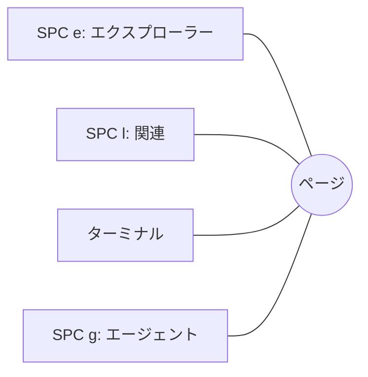

# 検索とパネル

**Ctrl+G** (または SPC SPC、SPC /) でワークスペースを単語で検索します。モデルがあれば意味でも検索できます。左にヒット、右にヒット箇所のファイルが表示され、Enter で開きます。

**/** で今いるペイン内の単語を検索し、**n** と **N** で再検索します。

**パネル** はページの上に開き、その下でページが動くことはありません:

- **SPC e** エクスプローラー: すべてのワークスペースのフォルダーとファイル
- **SPC l** 関連: このファイルのリンク先と、このファイルへのリンク元
- **SPC `** ターミナル: ワークスペースのフォルダーでシェルを実行
- **SPC g** AI エージェントの CLI (システム › エージェントプロファイル…)

**Ctrl+h j k l** (ノーマルモード) で、ページとパネルの間を行き来します。

**どのパネルも移動とサイズ変更ができます。** Alt (Mac では Option) を押しながら左ボタンでドラッグすると好きな場所へ移動し、右ボタンでドラッグするとサイズを変更します。**SPC L** (移動 › パネルを配置…) なら、キーボードで両方できます: `h j k l` で移動、`H J K L` でサイズ変更、Enter で確定、Esc で元に戻します。パネルは前回置いた場所に開きます。**移動 › パネルレイアウトをリセット** で、すべてのパネルを元のドック位置に戻します。

詳しくは: [リファレンス 第 3 章: モーダルエディターとパネル](../../reference/03-modal-editor-and-panels.md)、[リファレンス 第 5 章: ハイブリッド検索パイプライン](../../reference/05-hybrid-search-pipeline.md)。
