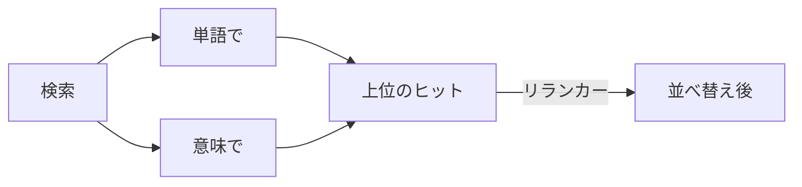

# 検索モデル: 埋め込みとリランカー

モデルがなければ、検索は単語によるものだけです。**システム › 検索モデル…** (SPC s) で、意味で検索するためのモデルを追加します。タブは 2 つあります。

**Embedding Models** (埋め込みモデル) は、ファイルの各セクションをベクトルに変換します。これにより、*意味* が同じものを検索で見つけられます。

1. プロバイダーを **追加…** します: 埋め込みモデルを入れたローカルの **Ollama** (`ollama pull nomic-embed-text`)、**Ollama Cloud**、またはキーを指定した任意の **OpenAI 互換** エンドポイントです。
2. **使用** します。ワークスペースのインデックスがバックグラウンドで作成され、ステータスラインのマークに検索中のモデル名が表示されます。
3. **インデックス作成を中止** で時間のかかる初回処理を止め、**単語のみ** で単語による検索に戻します。

**Ranker Models** (ランカーモデル) は第 2 段階です。リランカーが上位のヒットを質問と照らし合わせて読み、並べ替えます。

1. ランカーを **追加…** します: 種類、ベース URL、モデルを指定し、**確認** で動作を試します。
2. **使用** します。**ウィンドウ…** で、上位何件のヒットを読むかを設定します。

検索画面のチェックボックス (語彙検索、意味検索、再ランキング) で、検索ごとに使う段階を選びます。

詳しくは: [リファレンス 第 6 章: 埋め込みとリランカーの設定](../../reference/06-configuring-embeddings-and-rerankers.md)。
