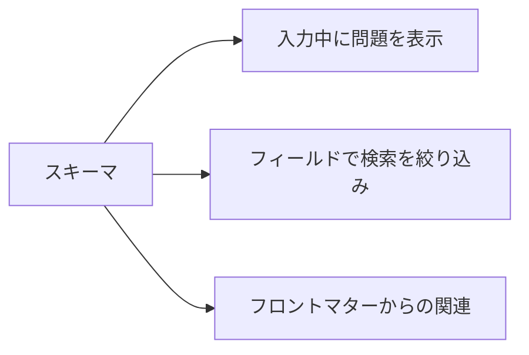

# ワークスペースとスキーマ

**ワークスペース** とは、AutoDoc がインデックスを作成するフォルダーです。Markdown、テキスト、YAML のファイルが対象で、`.git` は除外されます。

- **Ctrl+W** (SPC w) でワークスペースを切り替えます。Vim エディターモードの挿入モードでは、Ctrl+W は Vim のキーとして単語を削除するので、先に Esc を押してください。
- **管理…** (SPC W) で、ワークスペースの追加 (名前とフォルダー)、名前の変更、編集、削除ができます。削除で消えるのはインデックスだけで、ファイルは残ります。
- `autodoc --ui <name>` でそのワークスペースを開きます。名前を省くと、前回使ったものが開きます。

**スキーマ** は、ドキュメントのフロントマターに何が入るか (フィールド、その種類、取りうる値) を定めます。**管理… › 編集…** でワークスペースにスキーマを設定します: ファイル名を指定します (推奨は `.autodoc/schema.yaml`)。

スキーマがあると:

- ページ上部の行に、入力中のファイルのフロントマターの問題が表示されます。保存が妨げられることはありません。
- 検索をフィールドで絞り込めます: `type:adr` で ADR が見つかります。
- 関連が、フロントマターによるリンク (supersedes、sources、amends、related) を把握します。

スキーマがない場合、`field:value` は単語として検索されます。

詳しくは: [リファレンス 第 7 章: フロントマタースキーマと検証](../../reference/07-frontmatter-schemas-and-validation.md)。
