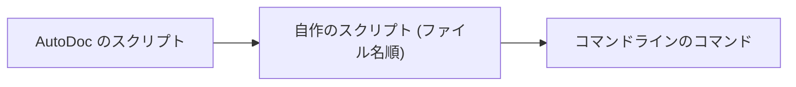

# Lua で独自のコマンドを作る

コマンドラインでは、Lua で書かれたコマンドを実行します。Vim のノーマルモードでは **:** で、どのモードでも **Ctrl+;** で開けます。ターミナルが Ctrl+; を送れない環境では **検索 › コマンドライン…** を使います。`:table` と `:mermaid` は AutoDoc 組み込みのコマンドです。自作のコマンドは `*.lua` ファイルとして、`config.toml` と同じ場所にある **`~/.config/autodoc/lua/`** に置きます。

**読み込み順。** 起動時にまず AutoDoc のスクリプトが読み込まれ、次にあなたのスクリプトがファイル名順に読み込まれます。すでに読み込まれたコマンドと同じ名前のコマンドは、それを置き換えます。つまり、自作のコマンドで AutoDoc のコマンドを置き換えることも、後のファイルで前のファイルのコマンドを置き換えることもできます。読み込みに失敗したファイルは通知として表示され、ほかのファイルはそのまま読み込まれます。編集したファイルを読み込み直すには **:lua-reload** を実行します (または AutoDoc でそのファイルを保存します)。



```lua
-- :upper [line] — upper-case a line, the cursor's by default
autodoc.command{
  name = "upper", aliases = {"up"}, args = "[line]", help = "upper-case a line",
  run = function(ed, args, line)
    local n = tonumber(args[1]) or ed:cursor()
    ed:replace(n, 1, n, #ed:line(n) + 1, ed:line(n):upper())
    autodoc.notify("upper-cased line " .. n)
  end,
}
```

**`name`** は入力するコマンド名、**`aliases`** はその別名、**`args`** と **`help`** は Tab で表示される内容です。**`run`** には、エディター `ed`、コマンドの後に続く単語 `args`、入力したままの行の残り `line` が渡されます。

**どのコマンドも ID で実行できます。** `autodoc.run("todos.open")` は AutoDoc のコマンドや自作のコマンド (`autodoc.run("lua.upper", "3")`) を実行し、`ok, err` を返します。F1 の COMMANDS の下に、すべての ID が一覧表示されます。

**エディター `ed`。** 位置は 1 始まりです: 1 行目の 1 列目が最初の文字です。範囲は開始位置から終了位置の手前までで、終了位置は含みません: `ed:text(2, 1, 2, 6)` は 2 行目の最初の 5 文字です。`ed:cursor()` と `ed:selection()` で現在位置がわかり、`ed:insert`、`ed:replace`、`ed:delete` で編集し、`ed:find(term)` で検索し、`ed:run("12")` で別のコマンドを実行します。1 つのコマンドで行った編集はすべて **1 回の取り消し** 単位になり、`u` でまとめて元に戻せます。

**サンドボックス。** スクリプトで使えるのは Lua の base、table、string、math ライブラリだけです。`os`、`io`、ファイルアクセス、`require` は使えません。失敗したスクリプトや 2 秒を超えて実行されたスクリプトは停止され、エラーがプロンプトに表示されますが、AutoDoc はそのまま動き続けます。

**完全なチュートリアル** は、`:hello` からデーモンに問い合わせる `:link` までを順を追って解説したもので、AutoDoc のリポジトリの `docs/lua/tutorial-vim-commands.md` にあります。

詳しくは: [リファレンス 第 14 章: Lua スクリプトとカスタムコマンド](../../reference/14-lua-scripting-and-custom-commands.md)。
