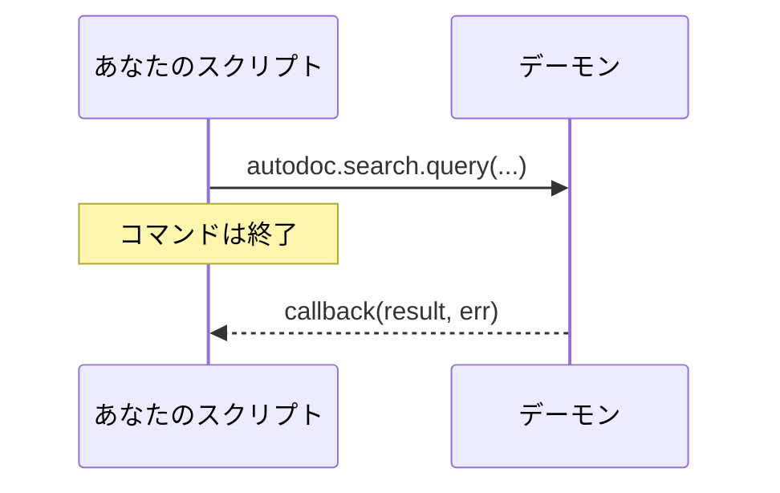

# Lua からデーモンを呼び出す

スクリプトは、TUI がデーモンに尋ねるのと同じことを尋ねられます: 検索、ファイルの読み込み、ワークスペースの一覧などです。デーモンがスクリプトに公開しているすべての動詞 (verb) は、`autodoc` の下に同じ名前の関数として用意されています:

```lua
autodoc.command{ name = "kestrels", run = function(ed)
  autodoc.search.query("kb", "kestrel", {limit = 5}, function(res, err)
    if err then autodoc.notify("search failed: " .. err) return end
    autodoc.notify(#res.hits .. " hits; the first is " .. res.hits[1].path)
  end)
end }
```

**応答は後から届きます。** 呼び出しはすぐに戻り、デーモンの応答は最後の引数であるコールバック `function(result, err)` に渡されます。その時点でコマンドは終了しているので、処理はコールバックの中で行います。コールバックはコマンドと同じ条件で実行されます: 制限時間は 2 秒、`ed` にアクセスでき、編集は 1 回の取り消し単位になります。その間にページが変わっている可能性があるので、位置はコールバック内で改めて取得してください。



**パラメーター** は、その動詞のものを順番に渡します。末尾の省略可能なパラメーターは省けます。数が合わないと呼び出し時にエラーになり、パラメーター名が示されます。キーが 1, 2, 3… のテーブルはリストとして、それ以外はマップとして渡され、整数値は整数として渡されます。結果は Lua のテーブルとして返ります。

**`autodoc.current_workspace()`** は使用中のワークスペースです (ワークスペースに入る前は nil)。ほとんどの動詞は、これを最初のパラメーターとして受け取ります。

**`autodoc.call(verb, params, cb)`** は、動詞を名前で呼び出します。パラメーターはリストで渡します: `autodoc.call("doc.read", {"kb", "a.md"}, cb)`。`autodoc.search` のような関数は、AutoDoc が接続したときに、接続先のデーモンをもとに作られます。ファイルの先頭ではなく、`run` の中で使ってください。

**どんな動詞がある?** `autodoc --contracts` で、すべての動詞とそのパラメーター、結果が表示されます。`autodoc --contracts 'search.*' --format md` なら、1 つのドメインを表形式で表示します。プロトコル自体の動詞 (`sys.hello`、`sys.shutdown`) はスクリプトからは呼び出せません。

**エラー。** 失敗した呼び出しは、デーモンのコードとメッセージを `err` としてコールバックに渡します: `"-32061 not found"` (コードの一覧は `--contracts` にあります)。コールバックがない場合、失敗は通知として表示されます。コールバック自体が失敗したり、実行に時間がかかりすぎたりした場合も同様です。**SPC h** ですべて確認できます。

詳しくは: [リファレンス 第 14 章: Lua スクリプトとカスタムコマンド](../../reference/14-lua-scripting-and-custom-commands.md)。
