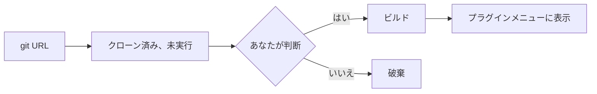

# プラグイン: 追加して使う

**プラグイン** は、AutoDoc が実行する独立したプログラムです。執筆中も動き続け、独自のダイアログやカードを描画し、ファイルやネットワーク、ほかのツールにアクセスできます。SQL ワークベンチの AutoDB もそのひとつです。

**追加する。** **プラグイン › git URL から追加…** を選び、リポジトリのアドレス (例: `https://github.com/yongjohnlee80/autodb`) を入力します。

1. AutoDoc はリポジトリをクローンしますが、まだ何も実行しません。
2. 何をビルドし、何を起動するかを示して確認を求めます: **はい、自己責任で** または **いいえ、キャンセル**。プラグインはあなたの権限で動き、あなたのファイルにアクセスできます。信頼できるプラグインだけを追加してください。**監査…** を選ぶと、先にエージェントのひとつにコードを読ませられます。その通知をクリックすると、この画面に戻って判断できます。
3. 「はい」を選ぶとビルドされ、プラグインが **プラグイン** メニューに表示されます。

**レジストリからも追加できます。** **プラグイン › レジストリを閲覧…** には、レジストリにあるプラグインと Lua パッケージが、それぞれの監査結果とともに一覧表示されます。**インストール** でも同じ確認があり、インストールされるコミットが監査済みかどうかも示されます。**git URL から追加…** にはレジストリ名も入力できます。

**3 つの種類。**

- **ダイアログ** はページの上に開き、Esc で閉じます。
- **カード** はページの横にドッキングし、隠れている間も動き続けます。AutoDB はカードです: カーソル位置の文を実行し、結果の行は AutoDoc の結果テーブルに表示されます。プラグインメニューにある **オフにする** 項目で停止します。
- **サービス** にはウィンドウがなく、バックグラウンドで動作します。

**コマンド。** **プラグイン** メニューにある各プラグインのサブメニューに、そのコマンドが並びます。**SPC p** はコマンドを持つプラグインを一覧表示します: `*` で好きな文字を割り当て、その文字を押すとコマンドが表示され、コマンドのキーを押すと実行されます。

**プラグインを管理…** では、プラグインの配置 (左か右、置ける場所) を決められます。**更新…** はリポジトリの最新版に更新し (同じ確認をもう一度行います)、**削除…** はプラグインを削除します。

**通知。** プラグインは、実行した内容や問題を、画面の隅に通知として伝えられます。**SPC h** で、その履歴をすべて確認できます。

詳しくは: [リファレンス 第 15 章: プラグインアーキテクチャとレジストリ](../../reference/15-plugin-architecture-and-registry.md)、[リファレンス 第 16 章: AutoDB ライブ SQL ワークベンチ](../../reference/16-autodb-live-sql-workbench.md)。
