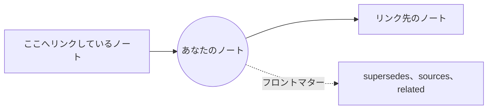

# 関連: リンク、Mindmap、GlobeMap

ノートは互いにリンクしています: Markdown のリンクと、フロントマター (supersedes、sources、related…) によってです。**関連** メニューは、それらのリンクを 3 通りの方法で表示します。

**リンク (SPC l)。** 開いているノートのつながりを表示するパネルです: リンク先、バックリンク、フロントマターの関連が、それぞれ見出しの下に並びます。どのドキュメントも指していないリンクも一覧に含まれます。**Enter** でノートを開くと、パネルは閉じます。**d** を押すと、2 リンク先のノートも一覧に加わります。どのターミナルでもウィンドウでも使えます。

**Mindmap** (GUI のみ)。あなたのノートを中心に、1 リンク先のノートがその周りに並びます。**d** で 2 リンク先まで広がります。ノートをクリックすると開き、マップがそのノートを中心に表示し直します。

**GlobeMap** (GUI のみ)。ワークスペース全体を一度に表示します: すべてのノートとすべてのリンクが、見ている間に落ち着く位置へと配置されていきます。

- ドラッグでパン、マウスホイールまたは **+** と **-** でズーム、**0** で全体が収まる表示に戻します。
- **f** で表示するリンクを選びます: すべてのリンク、本文のリンク、フロントマターの関連のいずれかです。
- **l** で凡例の表示と非表示を切り替えます。
- ノートをクリックすると開きます。

色は **グループ** から決まります。グループはスキーマのタイプやフォルダーをもとに初期設定されるので、ワークスペースの構造がひと目でわかります。凡例にグループ名が表示されます。**関連 › GlobeMap の設定…** と **Mindmap の設定…** で、それぞれの描画方法 (テーマ、色、名前など) を選べます。

詳しくは: [リファレンス 第 8 章: ナレッジグラフと ADR のライフサイクル](../../reference/08-knowledge-graphs-and-adr-lifecycle.md)。
