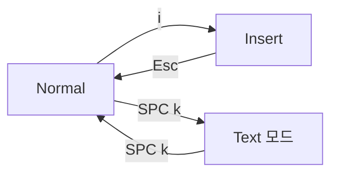

# 페이지와 두 가지 편집기 모드

AutoDoc은 파일을 **페이지**로 엽니다. 가운데에 읽기 좋은 너비로 놓이고, 원할 때까지 화면에 다른 것은 나타나지 않습니다.

편집은 두 모드 중 하나로 합니다. **SPC k** (옵션 › 편집기 모드)로 전환합니다.

- **Vim** (기본값): 모달 방식입니다. `i`로 입력하고 `Esc`로 Normal로 돌아가며, Normal의 키로 이동하고 편집합니다: `h j k l`, `w b e`, `dd`, `yy`, `p`, `u`. `?`를 누르면 Vim 키 카드가 나타납니다.
- **Text**: 모드가 없는 일반 편집기의 키를 씁니다. 누르는 대로 입력되고, 화살표로 이동하며, Ctrl+C, Ctrl+X, Ctrl+V로 복사, 잘라내기, 붙여넣기를 합니다.

**리더.** Vim의 Normal 모드에서 **Space**를 누르면 리더 카드가 열립니다. 명령마다 키가 하나씩 있습니다. 어느 모드에서든 **Ctrl+Space**로도 열 수 있습니다. 이어지는 내용 대부분은 이 카드의 키입니다.

**메뉴 막대**는 위쪽에 표시됩니다. 숨기도록 설정하면 (옵션 › 편집기 환경설정) 숨겨져 있다가 **F10**이나 **Alt+문자** (Mac에서는 Option+문자)를 누르면 나타납니다. **SPC m**을 누르면 메뉴 막대를 계속 표시합니다.

**독**은 메뉴 막대의 오른쪽 끝으로, 열린 위젯마다 아이콘이 하나씩 있습니다. 편집기 **✎**가 맨 앞에 오고, 그 뒤로 열려 있거나 닫힌 서랍 뒤에서 아직 실행 중인 패널이 이어집니다: 터미널의 셸, 에이전트, 플러그인 카드의 플러그인. 아이콘에 마우스를 올리면 이름이 보입니다. 표시된 패널을 클릭하면 숨겨지고, 숨겨진 패널을 클릭하면 두었던 그대로 다시 나타나며 키보드 포커스도 그 안으로 갑니다. 숨겨진 패널은 내용을 모두 그대로 유지하며, 아이콘이 흐리게 표시됩니다. **✎**를 누르면 표시된 패널이 모두 숨겨지고, 다시 누르면 같은 패널들이 돌아옵니다. GlobeMap, Mindmap, 링크 서랍에서 노트를 열 때도 같은 방식으로 숨겨집니다. 독에 편집기 말고 다른 것이 있는 동안에는 메뉴 막대가 계속 표시되고 페이지가 한 줄 아래에 놓입니다.

**Ctrl+S**로 저장합니다. **SPC o**는 워크스페이스의 문서를 열고, **Ctrl+N**은 새 문서를 만들며, **Ctrl+Q**는 종료합니다. Normal 모드에서 **Ctrl+O**는 링크 하나, 문서 하나 전에 있던 곳으로 돌아가고, **Ctrl+I**는 다시 앞으로 갑니다.

더 보기: [레퍼런스 3장: 모달 편집기와 패널](../../reference/03-modal-editor-and-panels.md).
