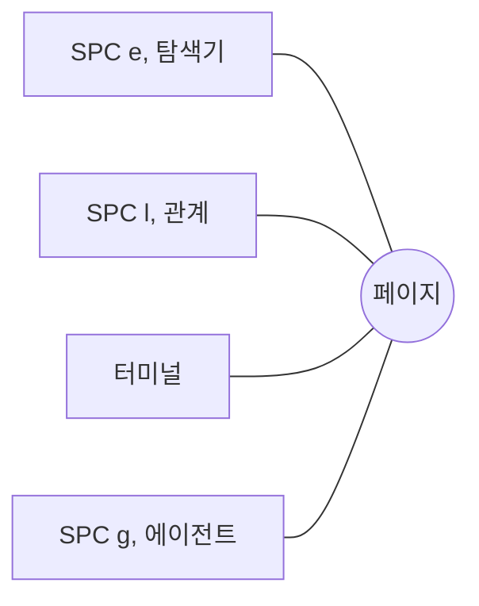

# 검색과 패널

**Ctrl+G** (또는 SPC SPC, SPC /)는 워크스페이스를 단어로 검색하며, 모델이 있으면 의미로도 검색합니다. 왼쪽에 결과가, 오른쪽에 결과 위치의 파일이 표시됩니다. Enter로 엽니다.

**/**는 지금 있는 창에서 단어를 찾고, **n**과 **N**으로 다시 찾습니다.

**패널**은 페이지 위에 열리며, 그 아래의 페이지는 움직이지 않습니다.

- **SPC e** 탐색기: 모든 워크스페이스의 폴더와 파일
- **SPC l** 관계: 이 파일이 링크하는 곳과 이 파일을 링크하는 곳
- **SPC `** 터미널: 워크스페이스 폴더에서 셸을 실행
- **SPC g** AI 에이전트의 CLI (시스템 › 에이전트 프로필…)

**Ctrl+h j k l** (Normal 모드)로 페이지와 패널 사이를 오갑니다.

**모든 패널은 옮기고 크기를 바꿀 수 있습니다.** Alt (Mac에서는 Option)를 누른 채 왼쪽 버튼으로 끌면 원하는 곳으로 옮기고, 오른쪽 버튼으로 끌면 크기를 바꿉니다. **SPC L** (이동 › 패널 배치…)은 키로 둘 다 합니다: `h j k l`로 옮기고, `H J K L`로 크기를 바꾸며, Enter로 유지하고, Esc로 되돌립니다. 패널은 남겨 둔 자리에서 열리며, **이동 › 패널 레이아웃 초기화**를 누르면 모두 다시 도킹됩니다.

더 보기: [레퍼런스 3장: 모달 편집기와 패널](../../reference/03-modal-editor-and-panels.md), [레퍼런스 5장: 하이브리드 검색 파이프라인](../../reference/05-hybrid-search-pipeline.md).
