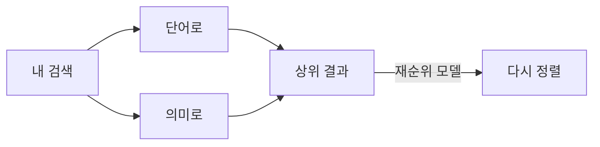

# 검색 모델: 임베딩과 재순위 모델

모델이 없으면 검색은 단어로만 합니다. **시스템 › 검색 모델…** (SPC s)에서 의미로 검색하는 모델을 추가합니다. 탭은 두 개입니다.

**Embedding Models**(임베딩 모델)는 파일의 각 섹션을 벡터로 바꿔, 검색이 *뜻이* 같은 것을 찾게 해 줍니다.

1. 제공자를 **추가…**합니다: 임베딩 모델이 있는 로컬 **Ollama** (`ollama pull nomic-embed-text`), **Ollama Cloud**, 또는 키를 갖춘 **OpenAI 호환** 엔드포인트.
2. **사용**을 누릅니다. 워크스페이스가 백그라운드에서 색인되며, 상태 줄의 표시가 검색 중인 모델의 이름을 보여 줍니다.
3. **색인 취소**는 오래 걸리는 첫 색인을 멈추고, **단어만**은 단어 검색으로 돌아갑니다.

**Ranker Models**(랭커 모델)는 두 번째 단계입니다. 재순위 모델이 상위 결과를 질문과 비교해 읽고 순서를 다시 매깁니다.

1. 랭커를 **추가…**합니다: 종류, 기본 URL, 모델을 입력하고, **확인**으로 시험해 봅니다.
2. **사용**을 누릅니다. **창…**에서 상위 결과를 몇 개까지 읽을지 정합니다.

검색 창의 체크박스(어휘, 의미, 재순위)로 검색마다 사용할 단계를 고릅니다.

더 보기: [레퍼런스 6장: 임베딩과 재순위 모델 설정](../../reference/06-configuring-embeddings-and-rerankers.md).
