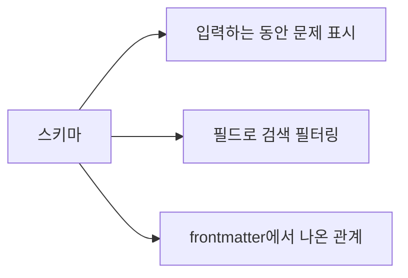

# 워크스페이스와 스키마

**워크스페이스**는 AutoDoc이 색인하는 폴더입니다. Markdown, 텍스트, YAML 파일을 색인하며 `.git`은 건너뜁니다.

- **Ctrl+W** (SPC w)로 워크스페이스를 전환합니다. Vim 편집기 모드의 Insert에서는 Ctrl+W가 Vim의 단어 지우기이므로 먼저 Esc를 누르세요.
- **관리…** (SPC W)에서 워크스페이스를 추가(이름과 폴더)하거나, 이름을 바꾸거나, 편집하거나, 삭제합니다. 삭제하면 색인만 지워지고 파일은 남습니다.
- `autodoc --ui <name>`은 그 워크스페이스를 엽니다. 이름이 없으면 마지막으로 쓴 워크스페이스를 엽니다.

**스키마**는 문서의 frontmatter에 무엇이 들어가는지 정합니다: 필드, 필드의 종류, 가질 수 있는 값. **관리… › 편집…**에서 워크스페이스에 스키마를 지정하세요. 파일 이름을 입력하며, 권장 위치는 `.autodoc/schema.yaml`입니다.

스키마가 있으면:

- 페이지 위의 줄이 입력하는 동안 파일의 frontmatter 문제를 알려 주며, 저장을 막지는 않습니다.
- 검색을 필드로 필터링할 수 있습니다: `type:adr`은 ADR을 찾습니다.
- 관계가 frontmatter로 만든 링크를 압니다: supersedes, sources, amends, related.

스키마가 없으면 `field:value`는 단어로 검색됩니다.

더 보기: [레퍼런스 7장: frontmatter 스키마와 검증](../../reference/07-frontmatter-schemas-and-validation.md).
