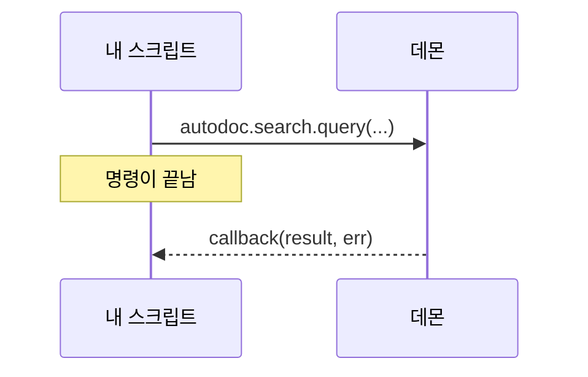

# Lua에서 데몬 호출하기

스크립트는 TUI가 데몬에 묻는 것을 똑같이 물을 수 있습니다: 검색, 파일 읽기, 워크스페이스 목록. 데몬이 스크립트에 제공하는 동사는 모두 `autodoc` 아래에 그 이름의 함수로 있습니다.

```lua
autodoc.command{ name = "kestrels", run = function(ed)
  autodoc.search.query("kb", "kestrel", {limit = 5}, function(res, err)
    if err then autodoc.notify("search failed: " .. err) return end
    autodoc.notify(#res.hits .. " hits; the first is " .. res.hits[1].path)
  end)
end }
```

**응답은 나중에 옵니다.** 호출은 바로 반환되고, 데몬의 응답은 마지막 인수인 콜백 `function(result, err)`으로 전달됩니다. 그때는 명령이 이미 끝났으므로, 작업은 콜백 안에서 합니다. 콜백은 명령과 같은 조건으로 실행됩니다: 2초 제한, `ed` 사용 가능, 편집은 실행 취소 한 번. 그사이 페이지가 바뀌었을 수 있으니 콜백 안에서 위치를 다시 읽으세요.



**매개변수**는 동사의 매개변수를 순서대로 넘기며, 끝에 있는 선택 매개변수는 생략할 수 있습니다. 개수가 틀리면 호출 시점에 매개변수 이름을 알려 주는 오류가 납니다. 키가 1, 2, 3…인 테이블은 목록으로, 그 밖의 테이블은 맵으로, 정수는 정수로 전달되며, 결과는 Lua 테이블로 돌아옵니다.

**`autodoc.current_workspace()`**는 사용 중인 워크스페이스입니다(워크스페이스에 들어가기 전에는 nil). 대부분의 동사가 첫 번째 매개변수로 받는 값입니다.

**`autodoc.call(verb, params, cb)`**는 이름으로 동사를 호출하며, 매개변수는 목록으로 넘깁니다: `autodoc.call("doc.read", {"kb", "a.md"}, cb)`. `autodoc.search` 같은 함수들은 AutoDoc이 연결될 때 연결된 데몬을 기준으로 만들어지므로, 파일 최상단이 아니라 `run` 안에서 쓰세요.

**어떤 동사가 있나요?** `autodoc --contracts`는 모든 동사와 매개변수, 결과를 출력하고, `autodoc --contracts 'search.*' --format md`는 한 도메인을 표로 출력합니다. 프로토콜 자체의 동사(`sys.hello`, `sys.shutdown`)는 스크립트에서 쓸 수 없습니다.

**오류.** 실패한 호출은 콜백에 `err`로 전달되며, 데몬의 코드와 메시지가 담깁니다: `"-32061 not found"` (`--contracts`가 코드 목록을 보여 줍니다). 콜백이 없으면 실패는 알림으로 표시됩니다. 콜백이 실패하거나 너무 오래 실행될 때도 마찬가지입니다. **SPC h**로 모두 볼 수 있습니다.

더 보기: [레퍼런스 14장: Lua 스크립팅과 사용자 명령](../../reference/14-lua-scripting-and-custom-commands.md).
