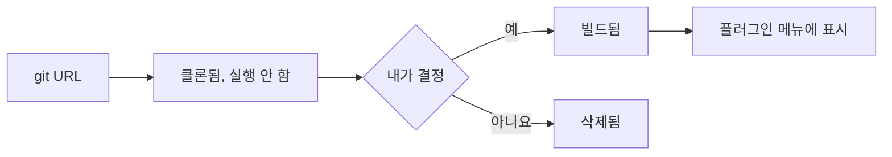

# 플러그인: 추가하고 사용하기

**플러그인**은 AutoDoc이 실행하는 독립된 프로그램입니다. 글을 쓰는 동안 계속 동작하고, 자체 대화상자나 카드를 그리며, 파일, 네트워크, 다른 도구에 접근할 수 있습니다. SQL 워크벤치인 AutoDB가 그 예입니다.

**추가하기.** **플러그인 › git URL에서 추가…**를 누르고 저장소 주소를 입력합니다. 예: `https://github.com/yongjohnlee80/autodb`.

1. AutoDoc이 저장소를 클론하며, 아직 아무것도 실행하지 않습니다.
2. 무엇을 빌드하고 무엇을 시작할지 보여 주고 묻습니다: **예, 책임은 내가 집니다** 또는 **아니요, 취소**. 플러그인은 내 권한으로 내 파일에 접근하며 실행되므로, 신뢰하는 플러그인만 추가하세요. **감사…**를 누르면 먼저 내 에이전트 하나가 코드를 읽어 봅니다. 그 알림을 클릭하면 돌아와서 결정할 수 있습니다.
3. 예를 누르면 빌드되고, 플러그인이 **플러그인** 메뉴에 나타납니다.

**레지스트리에서 추가하기.** **플러그인 › 레지스트리 둘러보기…**는 레지스트리가 아는 플러그인과 Lua 패키지를 각각의 감사 결과와 함께 보여 줍니다. **설치**도 같은 질문을 하며, 설치하려는 커밋이 감사를 받았는지 알려 줍니다. **git URL에서 추가…**에는 레지스트리 이름도 입력할 수 있습니다.

**세 가지 종류.**

- **대화상자**는 페이지 위에 열리며, Esc로 닫습니다.
- **카드**는 페이지 옆에 도킹되고, 숨겨져도 계속 실행됩니다. AutoDB가 카드입니다: 커서 아래의 문장을 실행하고, 결과 행은 AutoDoc의 결과 표로 갑니다. 플러그인 메뉴의 **끄기** 항목으로 멈춥니다.
- **서비스**는 창이 없고 백그라운드에서 동작합니다.

**플러그인의 명령.** **플러그인** 메뉴에서 각 플러그인의 하위 메뉴에 명령이 있습니다. **SPC p**는 명령이 있는 플러그인을 나열합니다: `*`로 플러그인에 나만의 문자를 지정한 뒤 그 문자를 누르면 명령이 보이고, 명령의 키를 누르면 실행됩니다.

**플러그인 관리…**에서는 플러그인의 위치(놓일 수 있는 왼쪽이나 오른쪽)를 정하고, **업데이트…**로 저장소의 최신 버전으로 올리며(같은 질문을 다시 합니다), **제거…**로 삭제합니다.

**알림.** 플러그인은 한 일이나 잘못된 점을 모서리의 알림으로 알려 줄 수 있습니다. **SPC h**에서 모든 알림 기록을 볼 수 있습니다.

더 보기: [레퍼런스 15장: 플러그인 아키텍처와 레지스트리](../../reference/15-plugin-architecture-and-registry.md), [레퍼런스 16장: AutoDB 라이브 SQL 워크벤치](../../reference/16-autodb-live-sql-workbench.md).
