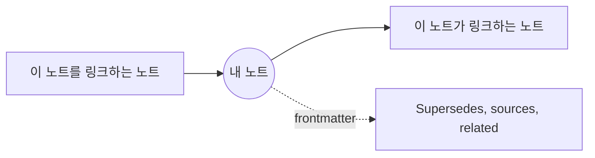

# 관계: 링크, Mindmap, GlobeMap

노트는 Markdown 링크와 frontmatter(supersedes, sources, related…)로 서로 연결됩니다. **그래프** 메뉴는 이 연결을 세 가지 방식으로 보여 줍니다.

**링크 (SPC l).** 열린 노트의 연결을 보여 주는 패널입니다: 이 노트가 링크하는 곳, 백링크, frontmatter 관계가 각각 제목 아래에 표시됩니다. 아무 문서도 가리키지 않는 링크도 나열됩니다. **Enter**로 노트를 열면 패널이 닫히고, **d**를 누르면 두 단계 떨어진 노트도 나열합니다. 모든 터미널과 창에서 쓸 수 있습니다.

**Mindmap** (GUI 전용). 내 노트가 가운데에, 한 단계 떨어진 노트들이 그 주위에 놓입니다. **d**를 누르면 두 단계까지 보여 줍니다. 노트를 클릭하면 열리고, 맵이 그 노트를 가운데로 옮깁니다.

**GlobeMap** (GUI 전용). 워크스페이스 전체를 한눈에 보여 줍니다: 모든 노트와 모든 링크가 보는 동안 제자리를 찾아갑니다.

- 끌어서 이동하고, 마우스 휠이나 **+**와 **-**로 확대/축소하며, **0**으로 전체를 다시 맞춥니다.
- **f**로 표시할 링크를 고릅니다: 모든 링크, 본문의 링크, 또는 frontmatter의 관계.
- **l**로 범례를 표시하거나 숨깁니다.
- 노트를 클릭하면 열립니다.

색상은 **그룹**에서 정해지며, 그룹은 스키마의 유형과 폴더를 바탕으로 만들어지므로 워크스페이스의 구조가 한눈에 보입니다. 범례가 그룹 이름을 알려 줍니다. **그래프 › GlobeMap 설정…**과 **Mindmap 설정…**에서 각각을 그리는 방식을 고릅니다: 테마, 색상, 이름 등.

더 보기: [레퍼런스 8장: 지식 그래프와 ADR 수명 주기](../../reference/08-knowledge-graphs-and-adr-lifecycle.md).
