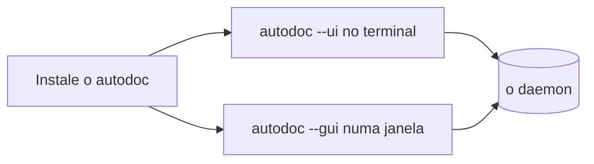

# Instalando o AutoDoc

O AutoDoc é um único programa, `autodoc`. Escolha o jeito que combina com a sua máquina:

| Em | Instale com |
| --- | --- |
| Linux, macOS, com Go | a janela: `GOBIN=~/.local/bin go install -tags gui github.com/yongjohnlee80/autodoc/cmd/autodoc@latest` |
| Qualquer um, com Go | a interface de terminal: `go install github.com/yongjohnlee80/autodoc/cmd/autodoc@latest` |
| macOS, Linux | mise: `mise use -g github:yongjohnlee80/autodoc` (com a janela) |
| Linux, um servidor ou contêiner | mise, a interface de terminal: `mise use -g 'github:yongjohnlee80/autodoc[asset_pattern=autodoc-*-linux-amd64-tui.tar.gz]'` (no arm64, `linux-arm64-tui`) |
| macOS, Linux | Homebrew: `brew install yongjohnlee80/tap/autodoc` (no Linux, a interface de terminal) |
| Linux, macOS | um arquivo de release da página Releases do projeto, `amd64` ou `arm64` |
| Windows | WSL2, e depois qualquer um dos jeitos do Linux |

**Dois jeitos de rodar.** `autodoc --ui` roda no seu terminal. `autodoc --gui` abre uma janela própria, com os diagramas desenhados e as fontes que você escolher. `--gui` é como você o roda; `-tags gui` é como o Go inclui a janela na compilação. No Linux, o mise e o arquivo de release sem sufixo trazem a janela e precisam das bibliotecas gráficas de um desktop (EGL, Wayland, X11), mesmo para `--ui`: num servidor ou contêiner, use o arquivo `-tui`. O Homebrew no Linux instala só a interface de terminal.

**O daemon se inicia sozinho.** Os dois conversam com um único programa em segundo plano, o daemon, que mantém o índice dos seus arquivos. O primeiro `autodoc --ui` ou `--gui` o inicia; os seguintes o compartilham. Você nunca precisa iniciá-lo à mão.

`autodoc --version` mostra qual versão você tem.

Mais: [Referência, Capítulo 2: Início rápido e espaços de trabalho](../../reference/02-quickstart-and-workspaces.md).
