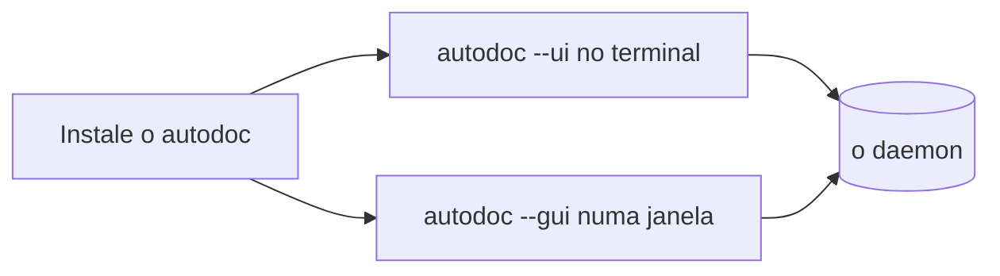

# Instalando o AutoDoc

O AutoDoc é um único programa, `autodoc`.

## O script de instalação (recomendado)

No Linux e no macOS, uma única linha instala o AutoDoc com a janela:

```sh
curl -fsSL https://github.com/yongjohnlee80/autodoc/releases/latest/download/install-autodoc.sh | sh
```

O script:

- baixa a versão mais recente para o seu sistema e a confere com o checksum da versão;
- instala como `~/.local/bin/autodoc`, só para você: nunca pede `sudo`;
- adiciona um atalho, para o AutoDoc aparecer entre os seus aplicativos (AutoDoc.app no macOS, uma entrada de desktop no Linux);
- instala o `update.sh` em `~/.local/state/autodoc`, que mantém o AutoDoc atualizado.

Se `~/.local/bin` não estiver no seu `PATH`, o script mostra a linha a adicionar ao arquivo de inicialização do seu shell; ele nunca edita esse arquivo. Quando nenhuma versão já compilada serve para o seu sistema, ele pergunta antes de compilar uma a partir do código-fonte da versão.

Rode de novo quando quiser: ele atualiza ou repara a instalação e nunca adiciona um segundo atalho. `sh install-autodoc.sh --help` lista as opções, como `--version` para uma versão específica e `--no-launcher`.

**Atualizando.** Instalado pelo script, o AutoDoc se atualiza sozinho: **Ajuda › Sobre**, depois **Atualizar**. A atualização roda no painel de terminal do AutoDoc e, quando a nova versão está pronta, o AutoDoc oferece **Reiniciar agora**. Num shell, `~/.local/state/autodoc/update.sh` faz o mesmo.

## Outros jeitos

- Homebrew: `brew install yongjohnlee80/tap/autodoc` (no Linux, só a interface de terminal)
- mise: `mise use -g github:yongjohnlee80/autodoc`
- Go: `go install -tags gui github.com/yongjohnlee80/autodoc/cmd/autodoc@latest` (sem `-tags gui`, só a interface de terminal)
- Um arquivo de release da página Releases do projeto
- Windows: WSL2 e, depois, o script de instalação

Esses são atualizados do mesmo jeito que foram instalados (`brew upgrade`, `mise upgrade`, `go install` de novo), então **Ajuda › Sobre** não oferece Atualizar para eles. Servidores, contêineres e compilar do código-fonte: [Referência, Capítulo 2](../../reference/02-quickstart-and-workspaces.md).

**Dois jeitos de rodar.** `autodoc --ui` roda no seu terminal. `autodoc --gui` abre uma janela própria, com os diagramas desenhados e as fontes que você escolher.



**O daemon se inicia sozinho.** Os dois conversam com um único programa em segundo plano, o daemon, que mantém o índice dos seus arquivos. O primeiro `autodoc --ui` ou `--gui` o inicia; os seguintes o compartilham. Você nunca precisa iniciá-lo à mão.

`autodoc --version` mostra qual versão você tem.

Mais: [Referência, Capítulo 2: Início rápido e espaços de trabalho](../../reference/02-quickstart-and-workspaces.md).
