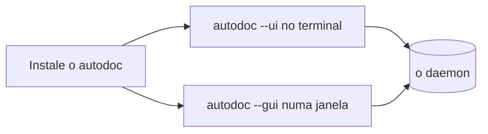

# Instalando o AutoDoc

O AutoDoc é um único programa, `autodoc`. Escolha o jeito que combina com a sua máquina:

| Em | Instale com |
| --- | --- |
| macOS, Linux | Homebrew: `brew install yongjohnlee80/tap/autodoc` |
| Linux, macOS | mise: `mise use -g github:yongjohnlee80/autodoc` |
| Linux, macOS | um arquivo de release da página Releases do projeto, `amd64` ou `arm64` |
| Qualquer um, com Go | `go install github.com/yongjohnlee80/autodoc/cmd/autodoc@latest` |
| Windows | WSL2, e depois qualquer um dos jeitos do Linux |

**Dois jeitos de rodar.** `autodoc --ui` roda no seu terminal. `autodoc --gui` abre uma janela própria, com os diagramas desenhados e as fontes que você escolher. No Linux, a janela precisa de um arquivo de release `-gui`, ou de `go install -tags gui …`.

**O daemon se inicia sozinho.** Os dois conversam com um único programa em segundo plano, o daemon, que mantém o índice dos seus arquivos. O primeiro `autodoc --ui` ou `--gui` o inicia; os seguintes o compartilham. Você nunca precisa iniciá-lo à mão.

`autodoc --version` mostra qual versão você tem.

Mais: [Referência, Capítulo 2: Início rápido e espaços de trabalho](../../reference/02-quickstart-and-workspaces.md).
