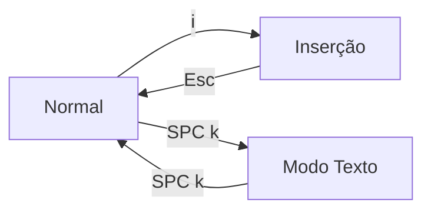

# A página e seus dois modos de editor

O AutoDoc abre um arquivo como uma **página**: centralizada, na largura boa para a leitura, e nada mais na tela até você pedir.

Ele edita em um de dois modos. **SPC k** (Opções › Modo do editor) alterna entre eles.

- **Vim** (o padrão): modal. `i` digita, `Esc` volta ao Normal, e as teclas do Normal movem e editam: `h j k l`, `w b e`, `dd`, `yy`, `p`, `u`. `?` mostra o cartão de teclas do Vim.
- **Texto**: sem modos, com as teclas de um editor comum. Digitar digita; as setas movem; Ctrl+C, Ctrl+X, Ctrl+V copiam, recortam e colam.

**O leader.** No modo Normal do Vim, **Espaço** abre o cartão leader: uma tecla para cada comando. Em qualquer modo, **Ctrl+Space** o abre. Quase tudo o que vem a seguir é uma tecla nele.

**A barra de menus** aparece no topo. Se você a configurar para se esconder (Opções › Preferências do editor), ela fica escondida até que **F10** ou **Alt+letra** a traga (no Mac, Option+letra). **SPC m** a mostra e a mantém visível.

**O dock** é a ponta direita da barra de menus: um ícone para cada widget aberto. **✎**, o editor, vem primeiro, depois cada painel aberto ou que ainda roda atrás da gaveta fechada: o shell de um terminal, um agente, o plugin de um cartão de plugin. Aponte para um ícone para ver o nome. Um clique num painel visível o esconde, e um clique num escondido o traz de volta como você o deixou, com o teclado nele. Um painel escondido guarda tudo o que tem, e o ícone dele fica esmaecido. **✎** esconde todos os painéis visíveis; clique de novo para trazer os mesmos de volta. Abrir uma nota pelo GlobeMap, pelo Mindmap ou pela gaveta de Links o esconde do mesmo jeito. Enquanto o dock lista mais que o editor, a barra fica visível e a página desce uma linha.

**Ctrl+S** salva. **SPC o** abre um documento do espaço de trabalho, **Ctrl+N** cria um novo, **Ctrl+Q** sai. No modo Normal, **Ctrl+O** volta para onde você estava, um link ou um documento atrás, e **Ctrl+I** avança de novo.

Mais: [Referência, Capítulo 3: Editor modal e painéis](../../reference/03-modal-editor-and-panels.md).
