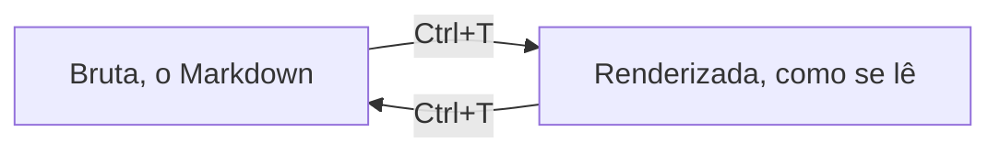

# A vista Renderizada: Ctrl+T

Com `autodoc --gui`, **Ctrl+T** alterna a página entre a vista **Bruta**, o Markdown como foi escrito, e a vista **Renderizada**: os títulos nos seus tamanhos, as marcações escondidas, tabelas, código e diagramas Mermaid desenhados.

A vista Renderizada continua sendo o editor. Toda linha é editável: a linha sob o cursor mostra o seu Markdown, as outras mostram o resultado. Ctrl+T de novo volta à Bruta.

**Arquivos HTML** perguntam como abrir: **Simplificado**, o texto deles somente leitura, ou **Bruto**, o próprio HTML para editar e salvar. A vista Renderizada de um arquivo HTML bruto é a página dele, desenhada nativamente com as próprias folhas de estilo e imagens: `j k` rolam, e os links abrem notas, arquivos e o navegador.

**Arquivo › Pré-visualizar HTML** (SPC H) abre a página da nota ao lado do editor, ao vivo enquanto você digita.

**O menu do botão direito**: Desfazer, Refazer, Copiar, Recortar e Colar, Ver diagrama, Ir para o link, Voltar e, na GUI, o Zoom. Pelo teclado: **Shift+F10**, a tecla **Menu** se o seu teclado tiver uma, ou **SPC .**.

Um terminal não tem vista Renderizada: ali a página fica na Bruta.

Mais: [Referência, Capítulo 4: Autoria rica, incorporações e exportação](../../reference/04-rich-authoring-embeds-and-export.md).
