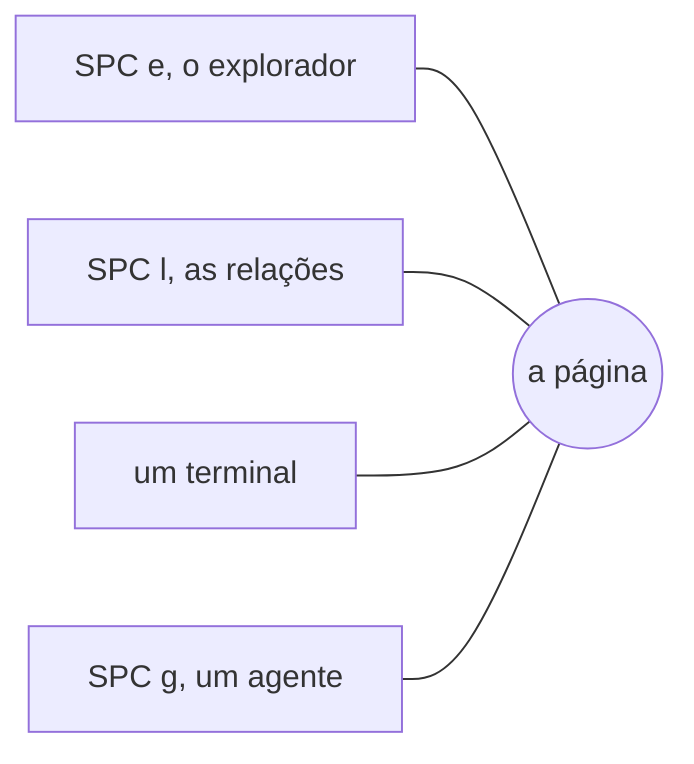

# A busca e os painéis

**Ctrl+G** (ou SPC SPC, SPC /) busca no espaço de trabalho por palavras e, com um modelo, por significado: os resultados à esquerda, o arquivo no ponto do resultado à direita. Enter o abre.

**/** encontra uma palavra no painel em que você está; **n** e **N** a encontram de novo.

**Os painéis** abrem sobre a página, sem que ela se mova por baixo:

- **SPC e** o explorador: as pastas e arquivos de todos os espaços de trabalho
- **SPC l** as relações: para onde este arquivo aponta, e o que aponta para ele
- **SPC `** um terminal, rodando o seu shell na pasta do espaço de trabalho
- **SPC g** a CLI de um agente de IA (Sistema › Perfis de agente…)

**Ctrl+h j k l** (modo Normal) vão da página para um painel e voltam.

**Todo painel se move e redimensiona.** Alt (Option no Mac) com o botão esquerdo o arrasta para qualquer lugar; com o botão direito, o redimensiona. **SPC L** (Ir › Organizar painel…) faz os dois pelo teclado: `h j k l` o movem, `H J K L` o redimensionam, Enter o mantém, Esc o devolve. Ele abre onde você o deixou; **Ir › Redefinir layout dos painéis** encaixa todos de novo.

Mais: [Referência, Capítulo 3: Editor modal e painéis](../../reference/03-modal-editor-and-panels.md) e [Referência, Capítulo 5: O pipeline de busca híbrida](../../reference/05-hybrid-search-pipeline.md).
