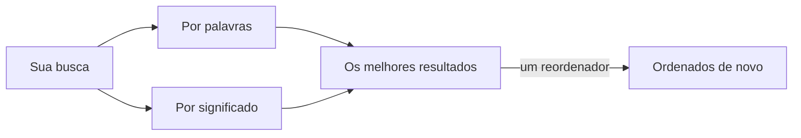

# Modelos de busca: embeddings e um reordenador

Sem um modelo, a busca é por palavras. **Sistema › Modelos de busca…** (SPC s) adiciona os modelos que buscam por significado. Ele tem duas abas.

Os **Embedding Models** (modelos de embedding) transformam cada seção dos seus arquivos num vetor, para que a busca encontre o que *significa* a mesma coisa.

1. **Adicionar…** um provedor: um **Ollama** local com um modelo de embedding (`ollama pull nomic-embed-text`), o **Ollama Cloud** ou qualquer endpoint **compatível com OpenAI**, com a chave dele.
2. **Usar**. O espaço de trabalho é indexado em segundo plano; a marca da linha de status nomeia o modelo que está buscando.
3. **Cancelar indexação** interrompe uma primeira passada longa; **Só palavras** volta à busca por palavras.

Os **Ranker Models** (modelos classificadores) são uma segunda etapa: um reordenador lê os melhores resultados à luz da sua pergunta e os ordena de novo.

1. **Adicionar…** um classificador: o tipo, a URL base e o modelo; **Verificar** o testa.
2. **Usar**. **Janela…** define quantos dos melhores resultados ele lê.

As caixas de seleção da busca (Lexical, Semântica, Reordenar) escolhem as etapas de cada busca.

Mais: [Referência, Capítulo 6: Configurando embeddings e reordenadores](../../reference/06-configuring-embeddings-and-rerankers.md).
