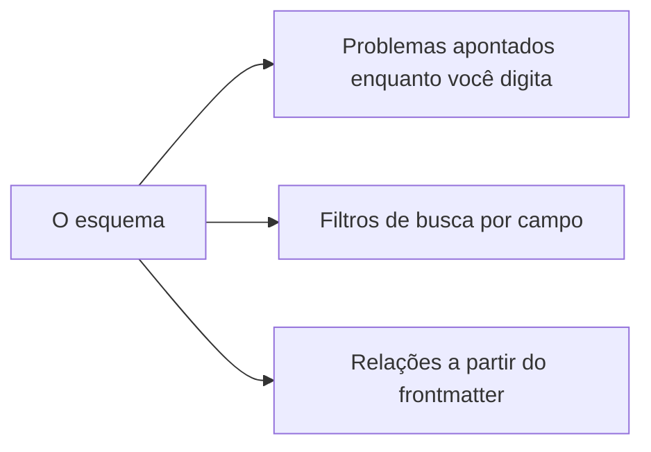

# Espaços de trabalho e seu esquema

Um **espaço de trabalho** é uma pasta que o AutoDoc indexa: os arquivos Markdown, de texto e YAML dela, com `.git` ignorado.

- **Ctrl+W** (SPC w) troca de espaço de trabalho. No modo Inserção do editor Vim, Ctrl+W é do Vim e apaga uma palavra: aperte Esc antes.
- **Gerenciar…** (SPC W) adiciona um (um nome e a pasta), renomeia, edita ou exclui. Excluir remove só o índice: os arquivos ficam.
- `autodoc --ui <name>` abre aquele espaço de trabalho; sem nome, o último usado.

**Um esquema** diz o que o frontmatter de um documento contém: os campos, os tipos deles e os valores que aceitam. Dê um ao espaço de trabalho em **Gerenciar… › Editar…**: indique o arquivo, sugerido `.autodoc/schema.yaml`.

Com um esquema:

- a linha sobre a página aponta os problemas de frontmatter de um arquivo enquanto você digita, sem nunca impedir um salvamento;
- a busca pode filtrar por um campo: `type:adr` encontra os ADRs;
- as relações conhecem os links que o frontmatter cria: supersedes, sources, amends, related.

Sem um, `field:value` é buscado como palavras.

Mais: [Referência, Capítulo 7: Esquemas de frontmatter e validação](../../reference/07-frontmatter-schemas-and-validation.md).
