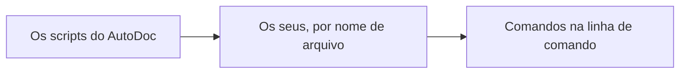

# Seus próprios comandos, em Lua

A linha de comando roda comandos escritos em Lua: **:** a abre no modo Normal do Vim, **Ctrl+;** em qualquer modo, e **Busca › Linha de comando…** onde um terminal não consegue enviar Ctrl+;. `:table` e `:mermaid` são do próprio AutoDoc; os seus ficam em **`~/.config/autodoc/lua/`**, ao lado de `config.toml`, como arquivos `*.lua`.

**Ordem de carregamento.** Na inicialização, os scripts do AutoDoc carregam primeiro, depois os seus, em ordem de nome de arquivo. Um comando com o mesmo nome de outro já carregado o substitui: os seus podem substituir os do AutoDoc, e um arquivo posterior, os de um anterior. Um arquivo que falha ao carregar vira uma notificação; os outros carregam mesmo assim. Rode **:lua-reload** (ou salve o arquivo no AutoDoc) para carregar um arquivo editado.



```lua
-- :upper [line] — upper-case a line, the cursor's by default
autodoc.command{
  name = "upper", aliases = {"up"}, args = "[line]", help = "upper-case a line",
  run = function(ed, args, line)
    local n = tonumber(args[1]) or ed:cursor()
    ed:replace(n, 1, n, #ed:line(n) + 1, ed:line(n):upper())
    autodoc.notify("upper-cased line " .. n)
  end,
}
```

**`name`** é o que você digita, **`aliases`** são outros nomes para ele, e **`args`** e **`help`** são o que o Tab mostra. **`run`** recebe o editor, `ed`; as palavras depois do comando, `args`; e o resto da linha como foi digitado, `line`.

**Qualquer comando, pelo id.** `autodoc.run("todos.open")` roda um comando do AutoDoc ou seu (`autodoc.run("lua.upper", "3")`) e retorna `ok, err`; o F1 lista todos os ids em COMANDOS.

**O editor, `ed`.** As posições começam em 1: linha 1, coluna 1 é o primeiro caractere. Um intervalo vai do início até o fim, sem incluí-lo: `ed:text(2, 1, 2, 6)` são os cinco primeiros caracteres da linha 2. `ed:cursor()` e `ed:selection()` dizem onde você está; `ed:insert`, `ed:replace` e `ed:delete` editam; `ed:find(term)` busca; `ed:run("12")` roda outro comando. Tudo o que um comando edita é **um único desfazer**: `u` desfaz tudo de uma vez.

**A sandbox.** Os scripts têm as bibliotecas base, table, string e math do Lua: nada de `os`, nada de `io`, nada de arquivos, nada de `require`. Um script que falha, ou que passa de dois segundos, é interrompido; o erro aparece no prompt, e o AutoDoc segue em frente.

**O tutorial completo**, passo a passo de `:hello` até um `:link` que consulta o daemon, é `docs/lua/tutorial-vim-commands.md` no repositório do AutoDoc.

Mais: [Referência, Capítulo 14: Scripts Lua e comandos personalizados](../../reference/14-lua-scripting-and-custom-commands.md).
